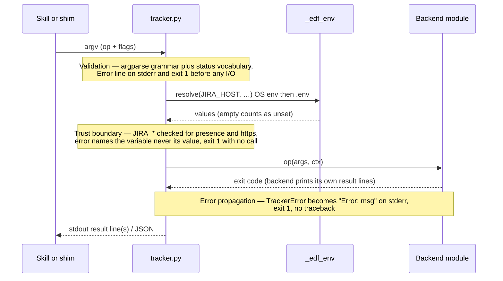
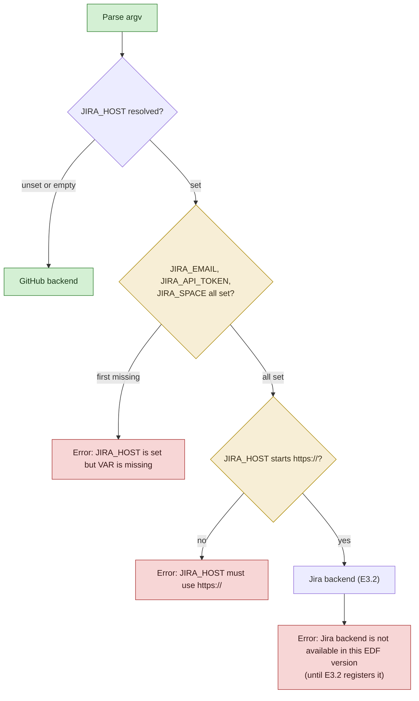
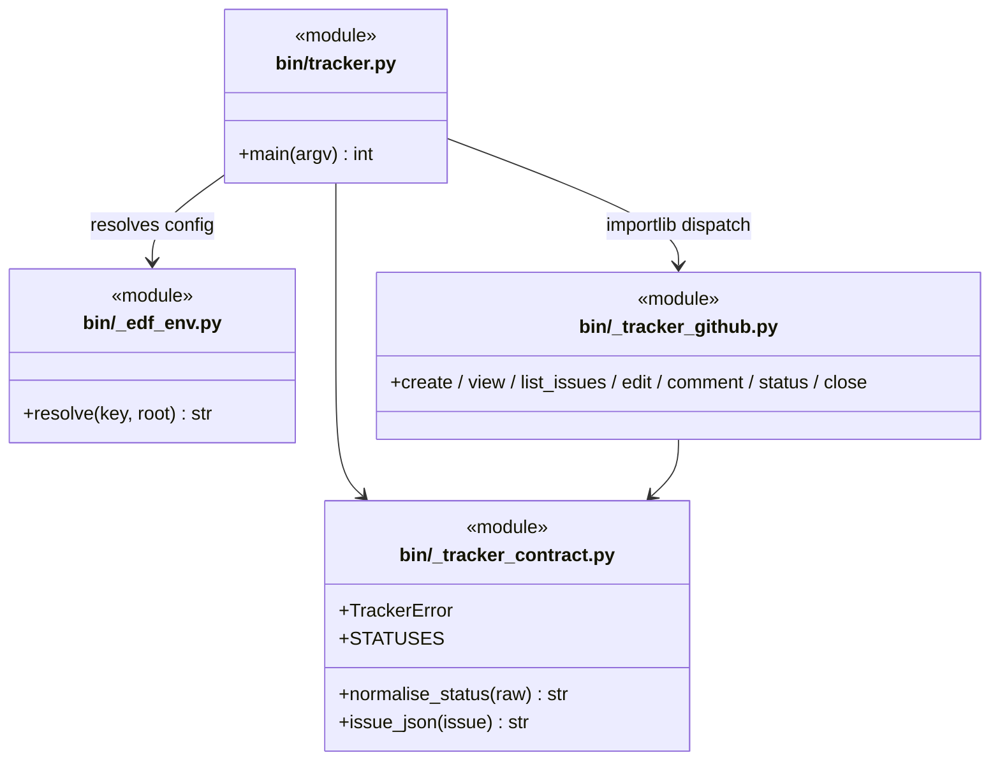
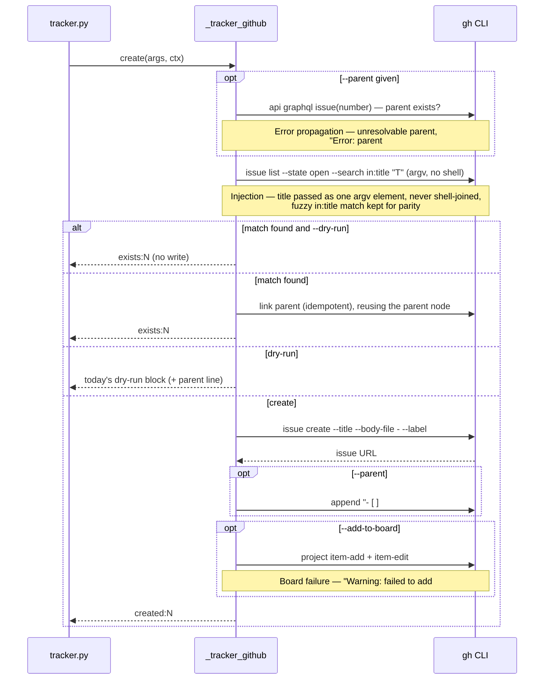
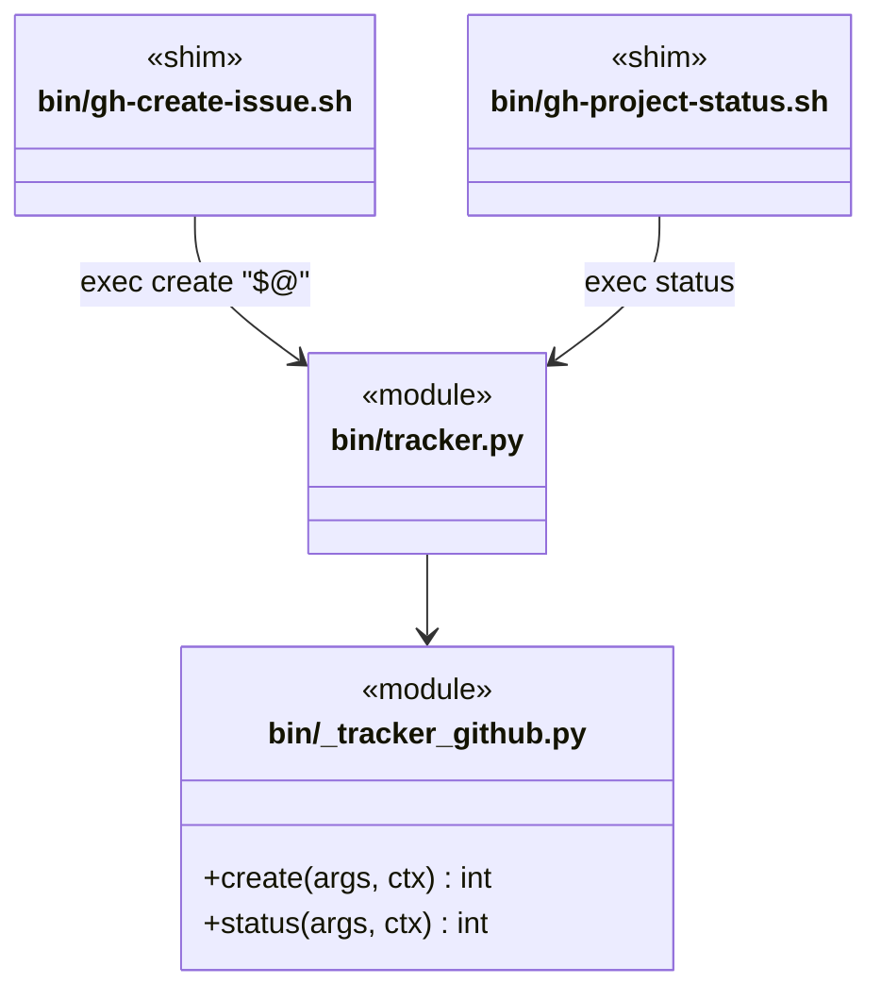
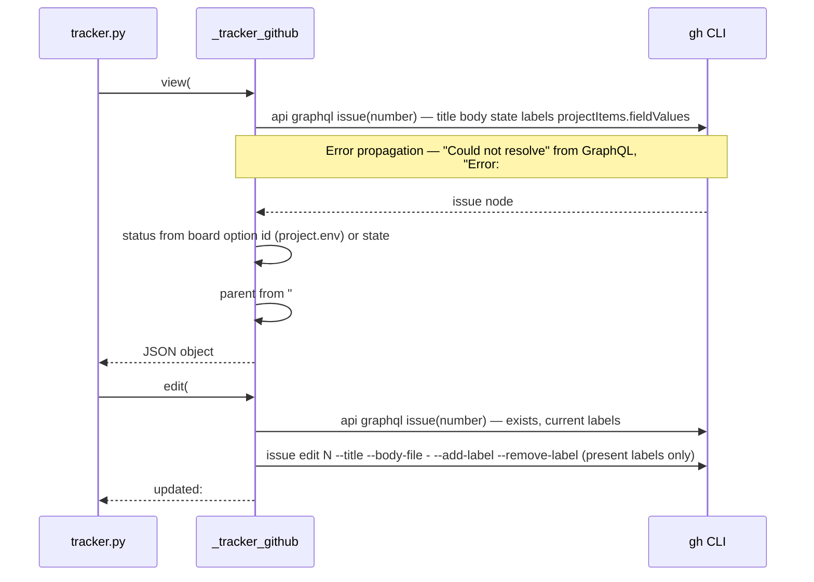
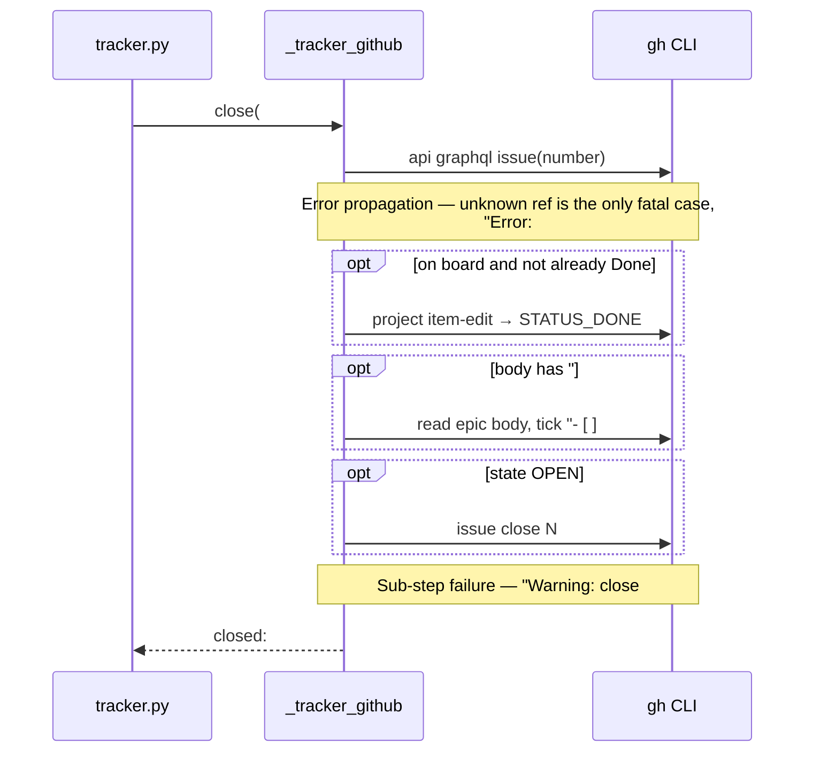
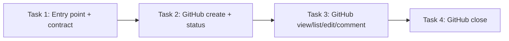

# Low-Level Design: V3 E3.1 — Tracker Script and GitHub Backend

## Document Control

| Field | Value |
|-------|-------|
| Version | 0.4 |
| Status | Revised |
| Author | LS / Claude |
| Created | 2026-11-15 |
| Revised | 2026-11-15 — Issue #118: §1.1 Part B (tracker.py decomposition, fake `gh` fixture) |
| Revised | 2026-11-15 — Issue #119: §1.2 Part B (helpers, golden overrides, `--parent` dedup guard), Open question 4 |
| Revised | 2026-11-16 — Issue #120: §1.3 Part B (board fields only when needed, `_require_issue`, query constants) |
| Epic | [#114](https://github.com/mironyx/engineering-delivery-framework/issues/114) |
| Parent | [v3-design.md](v3-design.md) (v0.4) — [C3.1](v3-design.md#c31-tracker-script), [C3.2](v3-design.md#c32-github-backend) |
| Requirements | [v3-requirements.md](../../requirements/v3-requirements.md) (v1.0) |
| Implementation plan | [2026-11-15-v3-implementation-plan.md](../../plans/2026-11-15-v3-implementation-plan.md#epic-e31--tracker-script-and-github-backend) |
| ADRs | [ADR-0041](../../adr/0041-tracker-abstraction.md), [ADR-0018](../../adr/0018-epic-task-organisation.md) |
| Epic id | `v3-e3-1` |

---

## Scope and AC split

This epic owns the tracker contract and every **GitHub** AC of Stories 1.1–1.5 and 2.1 AC4
(see the plan's *Story split across epics*). Jira ACs belong to E3.2, which adds
`bin/_tracker_jira.py` and registers it in the dispatch table defined here. Call sites are
not migrated here (E3.3); the old script names stay as shims until then.

## Open questions for the reviewer

Each is decided below so `/feature` is not blocked; confirm or overturn at review.

1. **GitHub `status` field in `view`/`list`.** GitHub has no native status. Decision: a closed
   issue is always `done`. An open issue takes its board column (matched by `FIELD_ID` and the
   option IDs in `.github/project.env`) when it is on the board, otherwise `todo`. Consequences
   for E3.3: on GitHub, `list --status todo --label kind:task` excludes open tasks sitting in
   In Progress on the board, whereas today's `/feature` (`gh issue list --label kind:task
   --state open --limit 1`) does not; and `list` filters status client-side after fetching the
   100 newest issues in the matching state, so older Todo issues can be missed when more than
   100 newer open issues are in other columns. Accepted at today's volume (tens of issues).
2. **`edit --title`.** Not in Story 1.4, but `/architect` Step 1 renames issues
   (`gh issue edit --title`), and E3.3 cannot migrate that call without it. Added.
3. **Epic checklist ownership.** Today `/architect` writes `- [ ] T<k> — <title>` lines and
   `gh-issue-manager` substitutes numbers. `create --parent` now also writes the checklist. To
   avoid duplicate lines, `--parent` replaces an existing `- [ ] T<k> — <title>` line whose title
   matches exactly, and otherwise appends. E3.3 should then drop the T-line substitution from
   `gh-issue-manager`.
4. **Intentional GitHub output changes.** Everything else is byte-identical (I6). These are not:
   - `gh-project-status.sh remove` (no caller, no test, grep-verified) prints the usage block.
   - `gh-project-status.sh` with fewer than two arguments prints usage even when
     `.github/project.env` is missing (today: the missing-config error comes first).
   - `create --add-to-board` no longer warns that `gh-project-status.sh` is not executable,
     because the board code now runs in-process.
   - A value flag with no value (`--title` as the last argument) prints
     `Error: --title needs a value` instead of bash's `unbound variable` error.
   - `gh-project-status.sh <unknown-number> <status>` prints gh's `Could not resolve…` line and
     exits 1, as today, but without the Python traceback that today's `parse-project-item-id.py`
     adds on empty input.
   - `gh-create-issue.sh` when the `gh issue create` output has no trailing number, and
     `gh-project-status.sh` for an issue not on the board, exit 1 with **no output** today:
     `set -e` + `pipefail` on the command substitution kills the script before its error line.
     The port prints `Error: could not extract issue number from: <url>` (stderr) and
     `Error: issue #N not found on the project board` (stdout) respectively.
   - An empty `--title ""` / `--body ""` stays "required", as bash's `[[ -z ]]` made it.

---

# Part A — Human-Reviewable Design

## 1.1 Tracker entry point

**Stories:** 1.1 (AC1–AC5), 1.5 AC6 (status vocabulary), contract for 1.2–1.5
**Layers:** BE (CLI)

### Purpose

One CLI, `bin/tracker.py`, parses every operation, resolves configuration through the
existing `_edf_env` precedence, picks the backend and hands over. It owns the argument grammar,
the status vocabulary and the error contract. It never calls an API itself.

### Behavioural Flows





### Structural Overview



### Invariants

| # | Invariant | Verification |
|---|-----------|-------------|
| I1 | A Jira config error makes no `gh` call and no network call | Test: fake `gh` on `PATH` records calls, assert log empty after each config error |
| I2 | The `JIRA_API_TOKEN` value never appears in stdout or stderr | Test: set token to a sentinel, run every config-error path and `tracker`, assert sentinel absent from both streams |
| I3 | Only `tracker.py` reads `JIRA_*` variables | Grep: `JIRA_` occurs in `bin/` only in `tracker.py` and (later) `_tracker_jira.py` |
| I4 | No backend module is imported before config validation succeeds | Test: drop `_tracker_github` from `sys.modules`, call `tracker.main()` with a Jira config error, assert it is still absent |
| I5 | Every error raised in `tracker.py` or `_tracker_contract.py` exits 1 with one `Error: …` line on stderr and no traceback (GitHub parity messages are governed by I6) | Test: each §1.1 error case asserts `returncode == 1`, stderr starts `Error: `, `Traceback` absent |

### Acceptance Criteria

- [ ] `JIRA_HOST` unset (or empty) → GitHub backend; `tracker` prints `github`.
- [ ] All four `JIRA_*` set in the OS env or only in `.env` → Jira selected; the OS value wins when both are set.
- [ ] `JIRA_HOST` set and any companion missing → `Error: JIRA_HOST is set but <VAR> is missing`, exit 1, no call (I1).
- [ ] `JIRA_HOST` not `https://` → `Error: JIRA_HOST must use https://`, exit 1.
- [ ] Unknown status → `Error: unknown status '<s>'. Use: todo | blocked | "in progress" | done`, exit 1.
- [ ] `tracker` makes no network call and runs the same validation.

### BDD Specs

```python
describe("tracker selection")
  it("uses GitHub when JIRA_HOST is unset")
  it("uses GitHub when JIRA_HOST is set to an empty placeholder")
  it("selects Jira from OS env")
  it("selects Jira from .env only")
  it("prefers the OS value over .env")
  it("reads .env from the main repo root when run in a linked worktree")
describe("Jira config validation")
  it("names JIRA_EMAIL / JIRA_API_TOKEN / JIRA_SPACE when each is missing, first missing wins")
  it("rejects http:// hosts")
  it("makes no gh call on any config error")
  it("never prints the token value")
  it("reports the Jira backend as unavailable once config is valid")
  it("prints the tracker name without any gh call")
describe("grammar")
  it("rejects an unknown status with the vocabulary listed")
  it("rejects an unknown operation with exit 1")
  it("requires --title and --body for create")
  it("requires at least one change flag for edit")
```

### HLD coverage assessment

- C3.1 — sufficient; this section pins the grammar, exit codes and module split.

## 1.2 GitHub `create` and `status`

**Stories:** 1.1 AC1, 1.2 (GitHub AC9, AC4, AC7, AC8), 1.5 AC7
**Layers:** BE (CLI)

### Purpose

Port `gh-create-issue.sh` and `gh-project-status.sh` into `_tracker_github.py` with
byte-identical stdout, stderr and exit codes, then turn both bash scripts into shims. Adds
`--type epic` (→ `epic` label) and `--parent` (validated, linked both ways in issue bodies).

### Behavioural Flows



`status <ref> <status>` is a straight port: load `.github/project.env`, find the item by
GraphQL, `gh project item-edit`, print `Issue #N → <status>`. With `--add-to-board` it is
today's `add` path: `item-add` then `item-edit`, `Issue #N → added → <status>`.

### Structural Overview



### Invariants

| # | Invariant | Verification |
|---|-----------|-------------|
| I6 | GitHub `create`/`status` stdout, stderr and exit code equal today's scripts for the golden scenario matrix | Golden test: `tests/fixtures/tracker_golden/*.json` recorded from the pre-port bash scripts under fake `gh`, compared byte for byte |
| I7 | Every existing test in `TestGhCreateIssue` and `TestGhProjectStatus` passes unchanged through the shims | `tests/test_shell_scripts.py` unmodified in the PR diff, and green |
| I8 | No `gh` call is built by string concatenation or `shell=True` | Grep: `shell=True` absent from `_tracker_github.py`, every `subprocess.run` takes a list |
| I9 | `--parent` failure writes nothing | Test: parent missing → fake `gh` log has no `issue create`/`issue edit` |

### Acceptance Criteria

- [ ] With `JIRA_HOST` unset, `tracker create`/`status` and both shims reproduce the golden matrix (I6).
- [ ] `--type epic` adds the `epic` label (once) and changes nothing else.
- [ ] `--parent #E`: `Error: parent #E not found` if `#E` does not exist; otherwise the new (or existing) issue appears once as `- [ ] #N — <title>` in the epic's Tasks checklist, and the task body carries `## Parent epic\n#E`.
- [ ] `--dry-run` prints today's block plus `  parent: #E` when `--parent` is given; parent lookup and dedup still run; no write, including on a dedup hit.
- [ ] A title containing `"`, `\` or `'` reaches `gh` intact and raises no error.

### BDD Specs

```python
describe("github create — parity")
  it("prints created:N after gh issue create returns a URL")
  it("prints exists:N and creates nothing when in:title search hits")
  it("matches the golden dry-run block, with and without labels")
  it("warns on stderr and still prints created:N when the board add fails")
  it("fails with 'Error: --title is required' when the title is missing")
describe("github create — new flags")
  it("adds the epic label for --type epic")
  it("errors 'parent #E not found' and writes nothing")
  it("appends '- [ ] #N — title' under the epic's Tasks heading, replacing the architect placeholder")
  it("does not duplicate the checklist line on an exists: re-run")
  it("prepends '## Parent epic' to the task body when absent")
  it("passes a title with quotes and backslashes as a single argv element")
  it("adds epic only once when --labels already contains it")
  it("prints the parent line on --dry-run and writes nothing, even on a dedup hit")
  it("replaces a matching '- [ ] T2 — title' line instead of appending")
describe("github status — parity")
  it("prints 'Issue #N → in progress' after item-edit")
  it("prints today's not-on-board error on stdout with exit 1")
  it("adds then sets status for --add-to-board")
  it("errors on missing .github/project.env naming the path")
  it("errors outside a git repository")
  it("matches the golden output when gh project item-edit fails")
  it("echoes the status exactly as the caller passed it")
```

### HLD coverage assessment

- C3.2 — sufficient for behaviour; this section adds `--parent` placement rules and the golden-file parity mechanism.

## 1.3 GitHub `view`, `list`, `edit`, `comment`

**Stories:** 1.3 AC9, 1.4 AC1–AC5 (GitHub)
**Layers:** BE (CLI)

### Purpose

The read and enrich operations, returning C3.1's shared JSON shape. `parent` and `children`
come from issue bodies per ADR-0018; `status` per Open question 1.

### Behavioural Flows



`list` is one GraphQL `repository.issues` call (`first: 100`, `orderBy: CREATED_AT DESC`,
`states` from the status filter, `labels: [L]`) with the same node fields, filtered on derived
status client-side. `comment` is an existence check plus `gh issue comment N --body-file -`.

### Invariants

| # | Invariant | Verification |
|---|-----------|-------------|
| I10 | `view` and each `list` element have exactly the keys `ref, title, body, labels, status, parent, children`, in that order | Test: `list(json.loads(out).keys())` equals the tuple |
| I11 | `list` makes one `gh` call and returns ≤ 100 items | Test: fake `gh` log length 1; GraphQL variable `first` is 100 |
| I12 | Removing an absent label issues no `--remove-label` for it | Test: fake `gh` log argv |
| I13 | Bodies and comments go to `gh` on stdin, never argv | Test: fake `gh` log shows `--body-file -` and the text in recorded stdin |

### Acceptance Criteria

- [ ] `view #N` prints the JSON object; `status` follows Open question 1; `parent` is `"#E"` or `null`; `children` lists `#n` refs from `- [ ]`/`- [x]` lines (epics only, `[]` otherwise).
- [ ] `list [--status S] [--label L]` returns an array of the same objects, newest first, at most 100.
- [ ] `edit` replaces body/title, adds/removes labels, leaves other labels alone, prints `updated:#N`; an absent remove-label is a no-op.
- [ ] `comment #N --body MD` prints `commented:#N`.
- [ ] Unknown ref → `Error: #N not found` for view, edit and comment.

### BDD Specs

```python
describe("github view")
  it("returns the seven-key JSON for a task with a parent epic")
  it("returns children for an epic checklist with ticked and unticked lines")
  it("maps the board option id to the EDF status")
  it("falls back to todo for an open issue not on the board or without project.env")
  it("reports done for a closed issue whatever its board column")
  it("errors '#N not found' for an unknown number")
  it("accepts '123' and '#123' as the same ref")
describe("github list")
  it("filters by label server-side and status client-side")
  it("queries CLOSED issues for --status done and OPEN otherwise")
  it("makes exactly one gh call")
  it("surfaces a gh api graphql failure as an Error: line with exit 1")
describe("github edit and comment")
  it("adds and removes labels in one gh issue edit")
  it("renames the issue with --title")
  it("skips remove for a label the issue does not carry")
  it("sends the body on stdin")
  it("prints commented:#N")
  it("errors '#N not found' before any write")
```

### HLD coverage assessment

- C3.2 — needs extension for GitHub `status` derivation (Open question 1) and the `list` query; both pinned here.

## 1.4 GitHub `close`

**Stories:** 2.1 AC4, closure half of C3.2
**Layers:** BE (CLI)

### Purpose

The merge-time closure `/feature-end` will call (E3.3): board → Done, tick the task in its
parent epic, close the issue — in today's order, idempotent, never failing on a sub-step.
Absorbs `check-epic-checkbox.py`, which becomes a shim.

### Behavioural Flows



### Invariants

| # | Invariant | Verification |
|---|-----------|-------------|
| I14 | Step order is board → epic tick → issue close | Test: fake `gh` log order |
| I15 | `close` on an already-closed, already-Done, already-ticked issue makes no write call and exits 0 | Test: fake `gh` log contains no `issue edit`, `issue close` or `project item-edit` call |
| I16 | A failing sub-step never changes the exit code | Test: each sub-step fails in turn → exit 0, one `Warning:` line, later steps still called |
| I17 | `tests/test_utils.py::TestCheckEpicCheckbox` passes unchanged | Unmodified in the PR diff, and green |

### Acceptance Criteria

- [ ] `close #N` moves the board item to Done, ticks `#N` in its parent epic, closes the issue, prints `closed:#N`.
- [ ] Each of: not on board, no project.env, no parent epic, already ticked, already closed — skipped silently, exit 0.
- [ ] A failing board, epic or close step prints one `Warning:` line on stderr and the remaining steps still run.
- [ ] `check-epic-checkbox.py` keeps its CLI and messages, delegating to the backend.

### BDD Specs

```python
describe("github close")
  it("runs board, epic tick and issue close in order and prints closed:#N")
  it("is a no-op write-wise on a fully closed issue")
  it("skips the board step when project.env is absent")
  it("skips the epic step when the body has no Parent epic section")
  it("continues to close the issue when the board update fails")
  it("continues to close the issue when the epic write fails")
  it("exits 1 only for an unknown ref")
describe("check-epic-checkbox shim")
  it("keeps _extract_parent_epic and _tick_checkbox behaviour")
  it("prints 'Epic #E: checked off #N' as today")
```

### HLD coverage assessment

- C3.2 — sufficient; this section pins the warning format and the skip conditions.

---

# Part B — Agent Implementation Detail

## External Surfaces

| Surface | Version / revision | Doc URL | Verified | New to repo |
|---------|--------------------|---------|----------|-------------|
| GitHub CLI `gh issue create/list/edit/close` with `--body`/`--label`/`--add-label`/`--remove-label` | `gh >= 2.46.0` (installed: 2.46.0) | https://cli.github.com/manual/gh_issue_edit, https://cli.github.com/manual/gh_issue_create | Yes — label flags take comma-separated names | No |
| GitHub CLI `--body-file -` (stdin) on `gh issue create/edit/comment`, and `gh issue comment` | `gh >= 2.46.0` | https://cli.github.com/manual/gh_issue_comment, https://cli.github.com/manual/gh_issue_edit | Yes — "use `-` to read from standard input" | Yes |
| GitHub CLI `gh project item-add/item-edit` | `gh >= 2.46.0` | https://cli.github.com/manual/gh_project_item-edit | Unverified — recall-based; argv copied verbatim from `gh-project-status.sh` | No |
| GitHub CLI `gh api graphql` with `-F owner='{owner}' -F name='{repo}'` placeholders | `gh >= 2.46.0` | https://cli.github.com/manual/gh_api | Yes — run against this repo 2026-11-15. `gh api --help` states placeholders resolve from the current directory or `GH_REPO`. Board lookups pass `REPO` literally, so they do not depend on it | Yes |
| `gh api graphql` not-found behaviour | `gh 2.46.0` (measured) | https://cli.github.com/manual/gh_api | Yes — measured 2026-11-15: unknown issue number → exit 1, stderr `gh: Could not resolve to an Issue with the number of N.` | Yes |
| GitHub GraphQL `Repository.issue`, `Repository.issues(first, states, labels, orderBy)` | GraphQL API, schema as of 2026-11-15 | https://docs.github.com/en/graphql/reference/repos | Yes — query run on this repo; `labels` is ANY-match (measured: 4 + 1 = 5) | Yes |
| GitHub GraphQL `ProjectV2Item.fieldValues`, `ProjectV2ItemFieldSingleSelectValue.optionId/field` | as above | https://docs.github.com/en/graphql/reference/projects | Yes — query run on #114, `field.id` matches `FIELD_ID` | Yes |

`gh issue close` on an already-closed issue: **Unverified — recall-based** (prints a notice,
exits 0). The design does not depend on it — `close` checks `state` first and treats any
non-zero exit as a warning.

## Reused helpers — DO NOT re-implement

| Helper | Import | Replaces |
|--------|--------|----------|
| `resolve(key, root)` | `import _edf_env` (bin dir on `sys.path`) | Reading `os.environ` / parsing `.env` directly. Note: an empty value counts as unset |
| `read_dotenv(root)` | `_edf_env` | Any second `.env` parser |
| `run-python.sh` | `hooks/run-python.sh` | Hard-coding `python3` in shims |
| `_extract_parent_epic` / `_tick_checkbox` regexes | moved from `bin/check-epic-checkbox.py` into `_tracker_github` in T3/T4 | New parent/checkbox regexes |

<a id="LLD-v3-e3-1-entry-point"></a>

## 1.1 Tracker entry point — Implementation

### File structure

```text
plugins/edf/bin/
  tracker.py             — CLI entry: grammar, config, dispatch (new)
  _tracker_contract.py   — TrackerError, status vocabulary, issue JSON (new)
tests/
  test_tracker.py        — selection, validation, grammar (new)
  fixtures/fake_gh.py    — fake gh executable driven by a scenario file (new)
  conftest.py            — add the `fake_gh` fixture (modify)
```

### Grammar (pinned)

```text
tracker.py tracker
tracker.py create  --title T --body MD [--labels a,b] [--type task|epic] [--parent REF]
                   [--add-to-board] [--board-status S] [--dry-run]
tracker.py view    REF
tracker.py list    [--status S] [--label L]
tracker.py edit    REF [--title T] [--body MD] [--add-label L]... [--remove-label L]...
tracker.py comment REF --body MD
tracker.py status  REF S [--add-to-board]
tracker.py close   REF
```

- `REF` is an opaque string; each backend parses its own form. `S` is one argv element
  (`"in progress"`).
- `--labels` is comma-separated (parity). `--add-label`/`--remove-label` repeat, one label each.
- `--add-to-board`/`--board-status` are GitHub board flags; E3.2 decides whether Jira ignores
  or rejects them.

### `_tracker_contract.py`

```python
STATUSES: tuple[str, ...] = ("todo", "in progress", "blocked", "done")
STATUS_ERROR = "unknown status '{raw}'. Use: todo | blocked | \"in progress\" | done"

class TrackerError(Exception):
    """Message without the 'Error: ' prefix. tracker.main prints it to stderr, exits 1."""

def normalise_status(raw: str) -> str:
    """Lower-case and validate; raises TrackerError(STATUS_ERROR) on anything else."""

@dataclass(frozen=True)
class Issue:
    ref: str; title: str; body: str; labels: list[str]
    status: str; parent: str | None; children: list[str]

def issue_json(issue: Issue | list[Issue]) -> str:
    """json.dumps(asdict(...), indent=2, ensure_ascii=False), key order as declared (I10)."""
```

`STATUS_ERROR` is byte-identical to `gh-project-status.sh`'s message, so it serves both the
Story 1.5 AC6 vocabulary and GitHub parity.

### `tracker.py` internal decomposition

```text
main(argv: list[str] | None = None) -> int
  - args = _parse(argv)                          # may raise TrackerError
  - ctx = _resolve_context(_env_root(), _repo_root())   # may raise TrackerError
  - if args.op == "tracker": print(ctx.tracker); return 0
  - backend = _load_backend(ctx.tracker)        # importlib, after validation (I4)
  - return getattr(backend, _OP_FUNCS[args.op])(args, ctx)
  - except TrackerError as e: print(f"Error: {e}", file=sys.stderr); return 1

_parse(argv) -> argparse.Namespace
  - op = argv[0]; unknown or missing op → TrackerError("unknown operation '<op>'. Use: tracker | create | view | list | edit | comment | status | close")
  - tracker takes no arguments; any extra → "unexpected argument '<arg>'"
  - create and status use hand-rolled parsers, because their output is parity-bound and
    argparse differs from the bash `while/case` loop (abbreviations, "unrecognized arguments",
    rejecting values that start with "-"):
    _parse_create(rest): each value flag consumes the next token verbatim, whatever it starts with;
      unknown flag → "unknown option '<arg>'"; flag with no value → "<flag> needs a value";
      then missing title → "--title is required", missing body → "--body is required" (that order)
    _parse_status(rest): positional REF and S, optional --add-to-board; S kept raw in
      args.status_raw; not exactly two positionals → "status needs REF and STATUS". Each backend's status() calls normalise_status itself — the GitHub backend
      after load_board(strict=True), because today's script reports config errors before an
      unknown status
  - view, list, edit, comment, close use argparse built by _argparser(op) (add_help=False,
    allow_abbrev=False, error() override that raises TrackerError(msg)); edit with no change flag →
    "edit needs one of --title, --body, --add-label, --remove-label"
  - --board-status is NOT validated at parse time: it is checked inside the board step, and an
    invalid value becomes the parity "Warning: failed to add #N to board" after the issue exists

_git(*args) -> str | None
  - `git rev-parse <args>` stdout, None on non-zero exit (outside a repo); shared by the two roots
  - git binary missing (OSError) → TrackerError("git is not installed or not on PATH"), never a
    silent fall back to cwd

_env_root() -> pathlib.Path
  - parent of `git rev-parse --git-common-dir` (as tag-session.py), so a linked worktree reads the
    main checkout's .env; outside a repo → Path.cwd()

_repo_root() -> pathlib.Path | None
  - `git rev-parse --show-toplevel` (worktree-local, holds .github/project.env); None outside a repo

@dataclass(frozen=True)
class JiraConfig: host: str; email: str; token: str; space: str   # repr=False on token

@dataclass(frozen=True)
class TrackerContext:
    env_root: Path; repo_root: Path | None; tracker: Literal["github", "jira"]; jira: JiraConfig | None

_resolve_context(env_root, repo_root) -> TrackerContext
  - host = _edf_env.resolve("JIRA_HOST", env_root); None → github
  - for var in ("JIRA_EMAIL", "JIRA_API_TOKEN", "JIRA_SPACE"): first missing →
    TrackerError(f"JIRA_HOST is set but {var} is missing")
  - not host.startswith("https://") → TrackerError("JIRA_HOST must use https://")

_BACKENDS = {"github": "_tracker_github"}      # E3.2 adds "jira": "_tracker_jira"
_OP_FUNCS = {"create": "create", "view": "view", "list": "list_issues", "edit": "edit",
             "comment": "comment", "status": "status", "close": "close"}
_load_backend(name) -> ModuleType
  - name not in _BACKENDS → TrackerError("Jira backend is not available in this EDF version")
```

### Test fixture — fake `gh`

`tests/fixtures/fake_gh.py` is run as `gh` through a wrapper the `fake_gh` fixture writes into
`tmp_path/bin` (prepended to `PATH`): `#!/bin/sh\nexec "<sys.executable>" "<fake_gh.py>" "$@"`.

- Scenario: `FAKE_GH_SCENARIO` points at a JSON list of rules
  `{"argv_prefix": [...], "stdout": "", "stderr": "", "exit": 0}`; the first rule whose prefix
  matches wins; no match → stderr `fake gh: unexpected call <argv>`, exit 97.
- Log: every call appends `{"argv": [...], "stdin": "..."}` to `FAKE_GH_LOG` (JSON lines).
- Stdin: logged only when the caller supplies it; the fake waits at most 2 s for stdin to become
  readable, so a `gh` call that inherits an open pipe cannot hang a test. Backends should still
  pass `input=` (or `DEVNULL`) explicitly.
- Fixture API: `fake_gh.rules(list[dict])`, `fake_gh.calls() -> list[dict]`, `fake_gh.repo`
  (the fresh repo to use as `cwd`), `fake_gh.bin_dir`.
- Isolation: the fixture deletes every `JIRA_*` variable from the test environment
  (`monkeypatch.delenv`) and runs subprocesses with `cwd` in a fresh `git init` repo under
  `tmp_path`, so the developer's own `.env` cannot select Jira. Existing shim tests that run
  with the repo as `cwd` stay unchanged (I7), so the suite assumes the repo's own `.env` has no
  `JIRA_HOST`. An autouse conftest fixture also scrubs `JIRA_*` from the OS environment. Accepted
  trade-off: a developer who points this repo itself at Jira through `.env` will see the shim
  tests fail until E3.3 retires the shims.
- POSIX only: tests using it carry `pytest.mark.skipif(sys.platform == "win32")`.

This runs the real subprocess path with no monkey-patching, the same reasoning ADR-0041 gives
for the Jira fake server. CLAUDE.md's respx rule covers HTTP, which this is not.

<a id="LLD-v3-e3-1-github-create-status"></a>

## 1.2 GitHub `create` and `status` — Implementation

### File structure

```text
plugins/edf/bin/
  _tracker_github.py      — GitHub backend (new; create, status, shared gh helpers)
  gh-create-issue.sh      — shim (rewrite)
  gh-project-status.sh    — shim (rewrite)
tests/
  test_tracker_github.py  — create/status behaviour and golden parity (new)
  fixtures/record_tracker_golden.py — recorder; scenario table, prepare_cwd(), tokenise() (new)
  fixtures/tracker_golden/<scenario>.json — {script, argv, tracker_argv, setup, rules, compare,
                                            stdout, stderr, exit[, port_stdout, port_stderr]} (new)
  fixtures/fake_gh.py     — rules gain optional "argv_contains" to tell lookups apart (modify)
```

### Golden matrix (record before rewriting the scripts)

Record each scenario by running the **pre-port** bash script under `fake_gh` and saving
argv, rules, stdout, stderr and exit. `tests/fixtures/record_tracker_golden.py` extracts the
scripts (and `parse-project-item-id.py`) from git at the last pre-port commit (`--rev`, default
`0f8ad5f`), so the goldens can be re-recorded after the shims replaced them. Run-specific paths
are tokenised: `{script}` (`$0` in usage text) and `{cwd}`. `tracker_argv` is the mapped
`tracker.py` argv, `null` for shim-only usage scenarios. `port_stdout`/`port_stderr`, when
present, replace stdout/stderr as the expected output for the intentional changes in Open
question 4 (the two silent exits); the bash bytes stay alongside.

| Script | Scenarios |
|--------|-----------|
| `gh-create-issue.sh` | created; exists; dry-run; dry-run with labels; add-to-board ok; add-to-board fails; `gh issue create` fails; URL without number; missing title; missing body; unknown option; body value starting with `-` |
| `gh-project-status.sh` | set status; mixed-case status echo; unknown issue; unknown status without project.env; not on board; `item-edit` fails; `add` with status; `add` default status; `add` without number; unknown status; missing project.env; outside git repo; missing config var; one argument; no arguments |

GraphQL responses in the rules carry the full `ISSUE_FIELDS` node, a superset of what today's
`find_item_id` query reads, so one rule set serves both the bash script and the port. The rules
match on argv prefix (`["api", "graphql"]`), not on the query text.

The no-argument and one-argument goldens are recorded in a repo **with** `project.env`, where
today's script prints usage; the missing-config ordering change is Open question 4.

The parity test runs `tracker.py` with the mapped argv (`create …` / `status N S` /
`status N S --add-to-board`) and the shim with the original argv, both compared to the golden.

### Shims

```bash
# gh-create-issue.sh
SCRIPT_DIR="$(cd "$(dirname "${BASH_SOURCE[0]}")" && pwd)"
exec bash "$SCRIPT_DIR/../hooks/run-python.sh" "$SCRIPT_DIR/tracker.py" create "$@"

# gh-project-status.sh
case "${1:-}" in
  add)    [[ $# -lt 2 ]] && { echo "Usage: $0 add <issue-number> [status]"; exit 1; }
          exec … tracker.py status "$2" "${3:-todo}" --add-to-board ;;
  remove) <today's four-line usage block on stdout>; exit 1 ;;
  *)      [[ $# -lt 2 ]] && { <today's usage block on stdout>; exit 1; }
          exec … tracker.py status "$1" "$2" ;;
esac
```

> **Constraint:** `$0` in the usage text must print the same path today's script prints, so
> the usage lines stay in the shim, not in `tracker.py`. The shims keep their header comment,
> reduced to "Deprecated shim — delegates to tracker.py (ADR-0041). Removed by E3.3."

### `_tracker_github.py` — shared helpers (T2)

```text
_gh(args: list[str], stdin: str | None = None) -> subprocess.CompletedProcess[str]
  - subprocess.run(["gh", *args], input=stdin or "", capture_output=True, text=True)  # never shell=True (I8)
  - input is always given (empty string when no body), so gh never inherits the caller's stdin

_parse_ref(ref: str) -> int
  - accepts "123" or "#123"; else TrackerError(f"invalid GitHub reference '{ref}'")

_issue_query(number: int, repo: str | None, *, board: bool = True) -> CompletedProcess
  - gh api graphql <owner/name> -F number=N -f query=(ISSUE_QUERY if board else _PLAIN_ISSUE_QUERY)
  - repo None → -F owner='{owner}' -F name='{repo}' (placeholders resolve only for -F; same repo as
    gh issue create); repo "owner/name" → -f owner=… -f name=… (raw strings, so a numeric-looking
    owner is not typed as a number). status passes board.repo, so the board lookup uses
    project.env's REPO exactly as today's find_item_id does
  - raw result: status passes gh's not-found stderr through untouched

_issue_node(result) -> dict | None
  - data.repository.issue; None for `issue: null`; malformed reply → TrackerError("unexpected gh api graphql response")

_fetch_issue(number: int, repo: str | None = None, *, board: bool = True) -> dict | None
  - _issue_query + _issue_node; None when gh exits non-zero with "Could not resolve to an Issue"
    on stderr (measured, see External Surfaces) or the node is null
  - other non-zero exit → TrackerError(f"gh api graphql failed: {stderr.strip()}")
  - board=False drops projectItems: create (parent lookup, dedup-hit task) uses it, so create
    never needs the read:project token scope. view/close (§1.3/§1.4) keep the default

_BASE_FIELDS = "number title body state labels(first:50){nodes{name}}"
ISSUE_FIELDS = _BASE_FIELDS + " projectItems(first:10){nodes{id project{id} fieldValues(first:20){nodes{
  ... on ProjectV2ItemFieldSingleSelectValue{optionId field{... on ProjectV2SingleSelectField{id}}}}}}}"
ISSUE_QUERY / _PLAIN_ISSUE_QUERY — the same query($owner,$name,$number:Int!) over each field set

_write_body(number: int, body: str) -> subprocess.CompletedProcess[str]
  - gh issue edit N --body-file -   (body on stdin, I13)
```

### Board helpers (port of `gh-project-status.sh`)

```text
@dataclass(frozen=True)
class Board: repo: str; number: str; project_id: str; field_id: str; options: dict[str, str]

_read_project_env(path) -> dict[str, str]   # KEY=VALUE parsing, separate from the error policy

load_board(repo_root: Path | None, *, strict: bool) -> Board | None
  - repo_root None (not a git repo) → strict: print today's message, raise _ParityExit(1); lenient: None
  - .github/project.env missing → strict: today's three stderr lines; lenient: None
  - parse KEY=VALUE: strip whitespace (incl. \r), strip one pair of surrounding quotes
    (xargs parity), skip blank and '#' lines
  - missing var → strict: "Error: <VAR> not set in <path>"; lenient: None

_board_item(board, node) -> tuple[str, str | None]
  - from a _fetch_issue node: (item id, option id) of the item with project.id == board.project_id,
    ("", None) when not on the board — no second GraphQL query

_board_set(board, item_id, status) -> CompletedProcess   # gh project item-edit …
_board_add(board, number) -> str                         # gh project item-add … --format json → id
  - "" when the reply has no id; gh failure → TrackerError(gh stderr);
    non-JSON reply → TrackerError(f"unexpected gh project item-add reply: {stdout}")
```

`_ParityExit(code)` is a private exception caught in `status`/`create` to return a parity exit
code after the backend has already printed the parity text itself.

### `create(args, ctx) -> int`

```text
1. title/body checks happen in tracker.main (parity messages).
2. labels = _labels(args.labels, args.type)  # --type other than task|epic → TrackerError("unknown type '<t>'. Use: task | epic");
     without --type epic labels pass through byte for byte; with it: split on ",", strip, append "epic" if absent, rejoin
3. parent = None; if args.parent: n = _parse_ref(args.parent); node = _fetch_issue(n, board=False)
     node None → TrackerError(f"parent #{n} not found")
4. existing = _find_existing(title): gh issue list --state open --limit 100 --search 'in:title "<title>"' --json number --jq '.[0].number'
     (failure swallowed, first line only — parity) → if non-empty: unless dry-run,
     _link_parent(existing=True); print "exists:<n>", return 0
5. dry-run → print today's block; insert "  parent: #E" after the labels line when parent; return 0
6. body = _with_parent_section(args.body, parent) when parent
   gh issue create --title T --body-file - [--label labels]; non-zero →
     stderr "Error: gh issue create failed: <stdout+stderr>", return 1
   number = trailing digits of URL; none → stderr "Error: could not extract issue number from: <url>", return 1
7. if parent: _link_parent(existing=False) → _link_child(parent_node, number, title)
     failure → stderr "Warning: failed to link #N to epic #E: <reason>", continue
8. if --add-to-board: _add_new_issue_to_board: board = load_board(lenient); normalise board_status;
     add + set; any failure (incl. board None) → stderr "Warning: failed to add #N to board" — no
     detail, because golden create-add-to-board-fails pins stderr to that line (bash ran the board
     step with >/dev/null 2>&1)
9. print f"created:{number}"; return 0
```

```text
_with_parent_section(body: str, parent: int) -> str
  - body already contains "## Parent epic" → unchanged; else f"## Parent epic\n#{parent}\n\n{body}"

_link_parent(parent_node, number, title, *, existing: bool) -> None
  - existing → _ensure_parent_section first; then _link_child; any TrackerError/KeyError/ValueError
    → the step 7 warning with the reason

_ensure_parent_section(number, parent, title) -> None     # dedup-hit path only
  - node = _fetch_issue(number, board=False); title must equal node["title"] exactly, else
    TrackerError("issue #N title differs") — the in:title search is fuzzy, so a near match is
    never written to; otherwise _with_parent_section + _write_body when the body changes

_link_child(epic_node: dict, child: int, title: str) -> None
  - uses epic_node["body"] from step 3 (no re-fetch); line = f"- [ ] #{child} — {title}"
  - re.search(rf"- \[[ xX]\] #{child}\b", body) → return (idempotent)
  - Tasks heading = first r"^#{2,3} Tasks\s*$" line. Within that section, replace in order of
    preference: a line r"- \[ \] T\d+ — <title>" with the exact title (Open question 3), then the
    kickoff placeholder "- [ ] (to be filled by edf:architect)"; otherwise insert after the
    section's last "- [" line, or directly under the heading if none
  - no Tasks heading → append f"\n### Tasks\n{line}\n"
  - the placement logic is the pure _add_checklist_line(body, child, title) -> str | None (None = already listed)
  - _write_body(epic, new_body); non-zero → TrackerError(f"failed to update epic #E: <gh stderr>") (caught in step 7)
```

### `status(args, ctx) -> int`

Port of the set-status and `add` commands, messages verbatim, including today's quirk that
`Error: issue #N not found on the project board` goes to **stdout** (also for an `issue: null`
reply). The item is found from the `_issue_query(n, board.repo)` node via `_board_item`. An
unknown issue number passes gh's stderr through (`_passthrough`) and exits 1 (golden scenario "unknown issue", compared on exit code and first stderr
line, see Open question 4). Status echo uses `args.status_raw` (`Issue #N → In
Progress` if the caller passed that case). A failing `gh project item-edit` passes gh's stderr
through and returns its exit code, as `set -e` does today.

<a id="LLD-v3-e3-1-github-read-edit"></a>

## 1.3 GitHub `view`, `list`, `edit`, `comment` — Implementation

### File structure

```text
plugins/edf/bin/_tracker_github.py      — add view, list_issues, edit, comment, _to_issue, _require_issue
tests/test_tracker_github.py            — add view/list/edit/comment tests (shared helpers, one `_node`)
tests/test_tracker.py                   — #118 grammar tests now observe the gh call, not the stub
```

### Functions

```text
_derive_status(node: dict, board: Board | None) -> str
  - node["state"] == "CLOSED" → "done", always (the PR merge closes the issue before
    /feature-end moves the board)
  - OPEN with board: option id from _board_item(board, node), reverse-mapped through
    board.options
  - otherwise, including an option id not in project.env (a custom column) → "todo"

parent_from_body(body: str) -> str | None
  - r"## Parent epic\s*\n+#(\d+)" → "#<n>". Copied from check-epic-checkbox.py, which keeps its
    own copy until §1.4 absorbs it.

children_from_body(body: str) -> list[str]
  - re.findall(r"^\s*- \[[ xX]\] #(\d+)\b", body, re.M) → ["#<n>", …], order kept, de-duplicated

_to_issue(node, board) -> Issue
  - children only when "epic" in labels, else []

_require_issue(ref: str, *, board: bool = False) -> tuple[int, dict]
  - shared existence check for view, edit and comment: _parse_ref, then _fetch_issue(n, board=board),
    None → TrackerError(f"#{n} not found")

view(args, ctx) -> int
  - board = load_board(ctx.repo_root, strict=False); node via _require_issue(board=board is not None)
  - print(issue_json(_to_issue(node, board)))

list_issues(args, ctx) -> int
  - status = args.status (normalised) ; states = ["CLOSED"] if status == "done" else ["OPEN"]
  - one gh api graphql call: repository.issues(first:100, states, labels:[label] if given,
    orderBy:{field:CREATED_AT, direction:DESC}) { nodes { fields } }, where fields is ISSUE_FIELDS
    (ISSUES_QUERY) when project.env exists and the base fields only (_PLAIN_ISSUES_QUERY) otherwise
  - non-zero exit → TrackerError(f"gh api graphql failed: {stderr.strip()}")
  - filter on _derive_status when status given; print issue_json(list)

edit(args, ctx) -> int
  - number, node = _require_issue(args.ref)   (never requests board fields)
  - remove = [l for l in args.remove_label if l in current labels]   (I12)
  - nothing to send (only absent removes) → print updated, return 0
  - gh issue edit N [--title T] [--body-file -] [--add-label a,b] [--remove-label c,d]
  - non-zero → TrackerError(f"gh issue edit failed: {stderr}")
  - print(f"updated:#{n}")

comment(args, ctx) -> int
  - _require_issue, then gh issue comment N --body-file - ; print(f"commented:#{n}")
```

> **Implementation note (issue #120):** `ISSUE_FIELDS` includes `projectItems`, which needs the
> `read:project` token scope. Requesting it unconditionally made edit, comment and board-less
> view/list fail on tokens without that scope, so only view and list request it, and only when
> `.github/project.env` exists.

`list` without `--status` returns open issues only (today's `gh issue list` default).

<a id="LLD-v3-e3-1-github-close"></a>

## 1.4 GitHub `close` — Implementation

### File structure

```text
plugins/edf/bin/_tracker_github.py   — add close, tick_checkbox, tick_parent_checkbox
plugins/edf/bin/check-epic-checkbox.py — shim over tick_parent_checkbox (rewrite)
tests/test_tracker_github.py         — add close tests
```

### Functions

```text
tick_checkbox(body: str, child: str) -> str
  - moved verbatim from check-epic-checkbox._tick_checkbox (child is digits)

tick_parent_checkbox(child: int, body: str) -> tuple[str, str]
  - returns (outcome, message) with outcome in {"no-parent", "already", "ticked"}
  - reads the epic with _fetch_issue(epic); None or failure → "Failed to read epic #E"
  - success messages are today's strings: "No parent epic found for issue #N" /
    "Epic #E: checkbox for #N already ticked or not found" / "Epic #E: checked off #N"
  - failures raise TrackerError with today's text: "Failed to read epic #E" /
    "Failed to update epic #E: <gh stderr>"
  - the shim prints success messages where today's script did (the no-parent one on stderr,
    the others on stdout) and, on TrackerError, prints its text to stderr and exits 1
  - close discards the success message: its only stdout line is closed:#N

close(args, ctx) -> int
  - n = _parse_ref; node = _fetch_issue(n) or TrackerError(f"#{n} not found")
  - _step("board", lambda: _board_set(done) unless _board_item says already Done / not on
    board, or project.env is absent)
  - _step("epic", lambda: tick_parent_checkbox(n, node["body"]))
  - if node["state"] == "OPEN": _step("issue close", lambda: gh issue close N)
  - print(f"closed:#{n}"); return 0

_step(name: str, fn: Callable[[], object]) -> None
  - runs fn; TrackerError or non-zero CompletedProcess → stderr f"Warning: close #{n}: {name} failed — {detail}"
```

### `check-epic-checkbox.py` shim

Keeps `_extract_parent_epic(body) -> str` (digits, `""` when none) and `_tick_checkbox` as thin
wrappers over `parent_from_body`/`tick_checkbox`, and `main()` with the same CLI, stdout/stderr
messages and exit codes, delegating to `tick_parent_checkbox`. Imports `_tracker_github` from
its own directory.

---

## Cross-References

### Internal

- §1.2 depends on §1.1 (grammar, `TrackerError`, `fake_gh`).
- §1.3 depends on §1.2 (`_gh`, `_fetch_issue`, `load_board`).
- §1.4 depends on §1.3 (`parent_from_body`) and §1.2 (`_board_item` for the already-Done check).

### External

- Depended on by E3.2 (registers `"jira"` in `_BACKENDS`, implements the same seven functions
  against `TrackerContext.jira`) and E3.3 (migrates call sites, drops the T-line substitution
  from `gh-issue-manager` per Open question 3, deletes the shims and
  `parse-project-item-id.py` once the guard test passes).

### Shared types

`TrackerError`, `Issue`, `STATUSES`, `TrackerContext`, `JiraConfig` — defined in §1.1, used by
every backend.

## kb/ additions

Paste into `plugins/edf/kb/architecture.md` under a new `## Issue tracker access` heading
(T1):

```markdown
## Issue tracker access

All issue operations go through `bin/tracker.py` (ADR-0041). Only `bin/_tracker_github.py`
may call `gh issue`, `gh project` or `gh api …/issues`; only `tracker.py` reads `JIRA_*`.
Environment values come from `_edf_env.resolve` (OS env, then `.env`; empty means unset).
Backends raise `_tracker_contract.TrackerError`; tests drive `gh` through the `fake_gh`
fixture, never by patching `subprocess`.
```

---

## Tasks

### Task 1: Tracker entry point and contract

**Issue title:** Tracker script entry point, config selection and contract
**Layer:** BE
**Depends on:** —
**Stories:** 1.1 (AC1–AC5), 1.5 AC6
**HLD reference:** [C3.1](v3-design.md#c31-tracker-script)

**What:** Create `tracker.py` and `_tracker_contract.py` with the pinned grammar, env-based
backend selection, Jira config validation and the error contract, plus the `fake_gh` test
fixture. Dispatch targets `_tracker_github`, which does not exist yet: T1 ships a stub module
whose every function raises `TrackerError("not implemented")`.

**Acceptance criteria:**
- [ ] §1.1 Acceptance Criteria and invariants I1–I5.
- [ ] `kb/architecture.md` gains the *Issue tracker access* entry.

**BDD specs:** §1.1 BDD Specs.

**Files to create/modify:**
- `plugins/edf/bin/tracker.py` — entry point
- `plugins/edf/bin/_tracker_contract.py` — shared contract
- `plugins/edf/bin/_tracker_github.py` — stub
- `tests/test_tracker.py`, `tests/fixtures/fake_gh.py`, `tests/conftest.py`
- `plugins/edf/kb/architecture.md`

### Task 2: GitHub create and status with shims

**Issue title:** GitHub backend create and status, byte-identical, with shims
**Layer:** BE
**Depends on:** Task 1
**Stories:** 1.1 AC1, 1.2 (GitHub AC9, AC4, AC7, AC8), 1.5 AC7
**HLD reference:** [C3.2](v3-design.md#c32-github-backend)

**What:** Record the golden matrix from the current scripts, port both into
`_tracker_github.py`, add `--type epic` and `--parent`, and turn the two bash scripts into
shims.

**Acceptance criteria:**
- [ ] §1.2 Acceptance Criteria and invariants I6–I9.
- [ ] `tests/test_shell_scripts.py` is unchanged and green.

**BDD specs:** §1.2 BDD Specs.

**Files to create/modify:**
- `plugins/edf/bin/_tracker_github.py` — create, status, shared and board helpers
- `plugins/edf/bin/gh-create-issue.sh`, `plugins/edf/bin/gh-project-status.sh` — shims
- `tests/test_tracker_github.py`, `tests/fixtures/tracker_golden/`, `tests/fixtures/record_tracker_golden.py`

### Task 3: GitHub view, list, edit and comment

**Issue title:** GitHub backend view, list, edit and comment
**Layer:** BE
**Depends on:** Task 2
**Stories:** 1.3 AC9, 1.4 AC1–AC5 (GitHub)
**HLD reference:** [C3.2](v3-design.md#c32-github-backend)

**What:** Implement the read and enrich operations with the shared JSON shape, `parent` and
`children` from bodies, and status derivation per Open question 1.

**Acceptance criteria:**
- [ ] §1.3 Acceptance Criteria and invariants I10–I13.

**BDD specs:** §1.3 BDD Specs.

**Files to create/modify:**
- `plugins/edf/bin/_tracker_github.py` — view, list_issues, edit, comment
- `tests/test_tracker_github.py`

### Task 4: GitHub close, absorbing check-epic-checkbox

**Issue title:** GitHub backend close — board, epic tick, issue close
**Layer:** BE
**Depends on:** Task 3
**Stories:** 2.1 AC4
**HLD reference:** [C3.2](v3-design.md#c32-github-backend)

**What:** Implement idempotent `close` in today's `/feature-end` order and make
`check-epic-checkbox.py` a shim over the backend.

**Acceptance criteria:**
- [ ] §1.4 Acceptance Criteria and invariants I14–I17.

**BDD specs:** §1.4 BDD Specs.

**Files to create/modify:**
- `plugins/edf/bin/_tracker_github.py` — close and checkbox helpers
- `plugins/edf/bin/check-epic-checkbox.py` — shim
- `tests/test_tracker_github.py`

---

## Execution Order

### Dependency DAG



### Execution Waves

| Wave | Tasks | Blocked by | Notes |
|------|-------|------------|-------|
| 1 | Task 1 | — | E3.2's converter task and E3.4 can run alongside |
| 2 | Task 2 | Wave 1 | Largest task (~300-line diff, mostly goldens and tests) |
| 3 | Task 3 | Wave 2 | Same file as T2 |
| 4 | Task 4 | Wave 3 | Same file; reuses T3's parsing |
