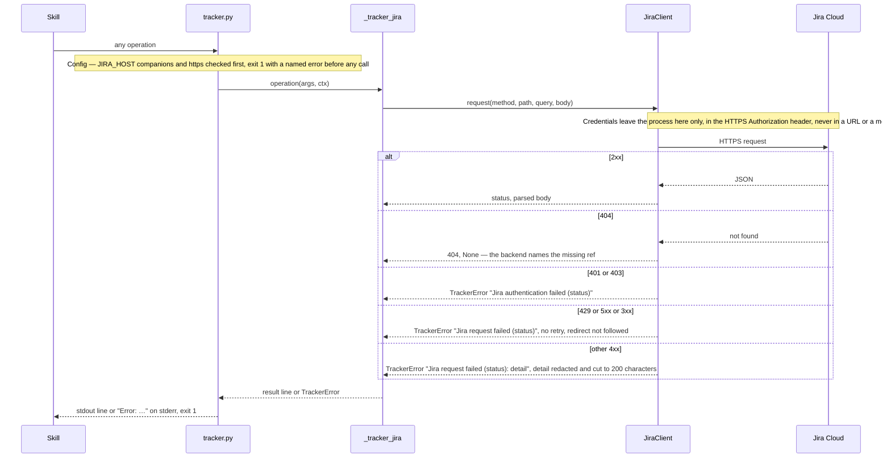
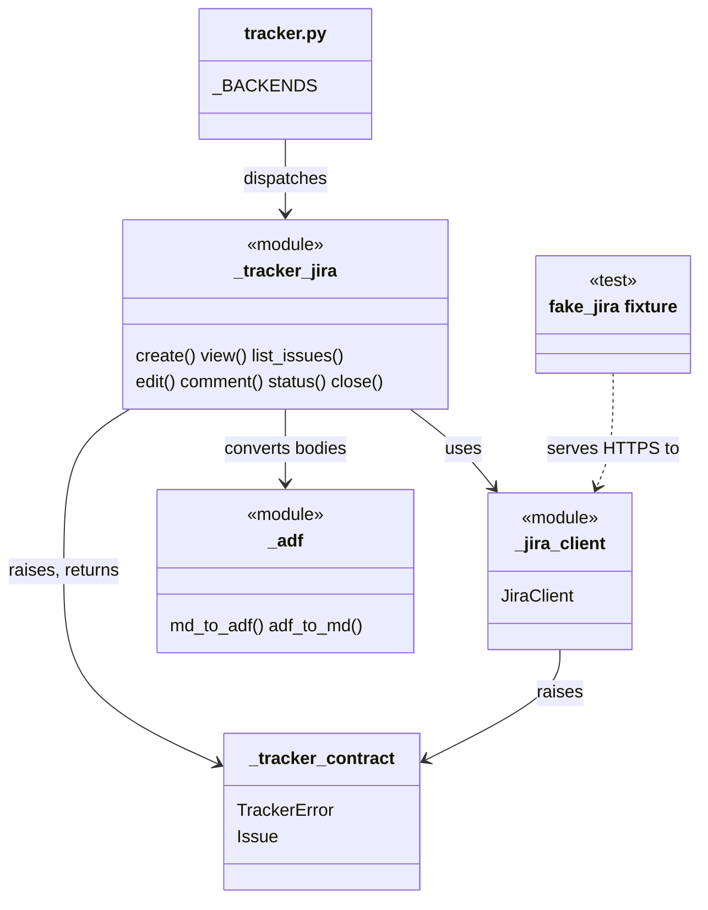
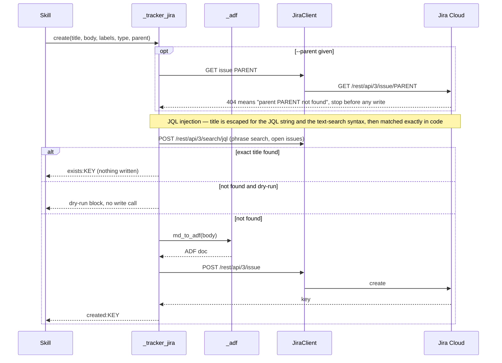
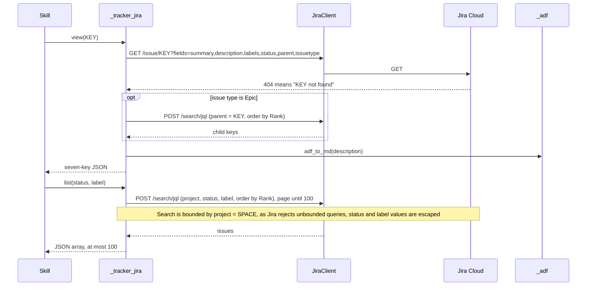
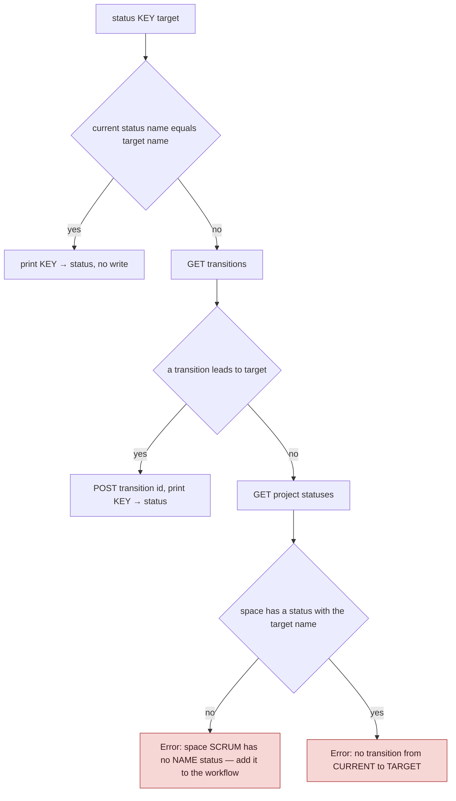
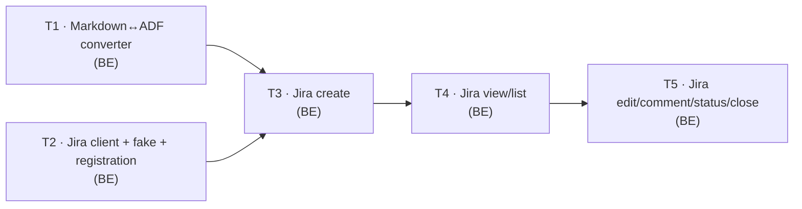

# Low-Level Design: V3 E3.2 — Jira Backend and Markdown↔ADF Converter

## Document Control

| Field | Value |
|-------|-------|
| Version | 0.1 |
| Status | Draft |
| Author | LS / Claude |
| Created | 2026-11-16 |
| Epic | [#115](https://github.com/mironyx/engineering-delivery-framework/issues/115) |
| Parent | [v3-design.md](v3-design.md) (v0.4) — [C3.3](v3-design.md#c33-jira-backend), [C3.4](v3-design.md#c34-markdownadf-converter) |
| Requirements | [v3-requirements.md](../../requirements/v3-requirements.md) (v1.0) |
| Implementation plan | [2026-11-15-v3-implementation-plan.md](../../plans/2026-11-15-v3-implementation-plan.md#epic-e32--jira-backend-and-markdownadf-converter) |
| ADRs | [ADR-0041](../../adr/0041-tracker-abstraction.md), [ADR-0018](../../adr/0018-epic-task-organisation.md) |
| Depends on | [lld-v3-e3-1-tracker-script.md](lld-v3-e3-1-tracker-script.md) — contract, dispatch, `fake_gh` pattern |
| Epic id | `v3-e3-2` |

---

## Scope and AC split

This epic owns the **Jira** half of Stories 1.1–1.5 and Story 2.2 AC4 (Jira `close` → Done). The
GitHub half shipped in E3.1; call sites do not move here (E3.3). Everything is standard library
only (ADR-0041): `urllib.request` for HTTP, no third-party packages.

## Open questions for the reviewer

Each is decided below so `/feature` is not blocked; confirm or overturn at review.

1. **Task-list checkboxes.** `taskList`/`taskItem` are absent from Atlassian's documented ADF node
   list (the node index lists blockquote, bulletList, codeBlock, date, doc, emoji, expand,
   hardBreak, heading, inlineCard, listItem, media*, orderedList, panel, paragraph, rule,
   status, table*, text). Decision: `- [ ] x` / `- [x] x` become a `bulletList` item whose
   paragraph text starts with the literal `[ ] ` or `[x] `, and convert back exactly. The UI
   shows plain brackets, not clickable boxes. Revisit only if the `SCRUM` smoke run shows
   `taskList` is accepted and worth the risk.
2. **`--add-to-board` and `--board-status` on Jira.** A Jira issue is on its board from
   creation, in the workflow's initial status. Both flags are accepted and ignored; `create`
   never transitions. `--board-status blocked` on GitHub therefore has no Jira equivalent at
   create time — callers use `status` afterwards.
3. **`exists:` with `--parent`.** On a duplicate title the Jira backend prints `exists:` and
   changes nothing, including the parent. (GitHub re-links the existing task into the epic
   body, because there the checklist is the link; on Jira `parent` is a field a prior run
   already set.)
4. **Duplicate check relies on the search index.** `summary` is a text field: JQL `=` is not
   supported on it, so the check searches the phrase with `~` and then compares the summary
   exactly in code. Jira's index is eventually consistent, so an issue created moments earlier
   in the same run can be missed. Accepted at `/architect` volume (sequential creates, distinct
   titles); the `SCRUM` smoke run checks it.
5. **`status` for a Jira status outside the fixed mapping.** `view`/`list` report such an issue
   by status category: `done` → `done`, `indeterminate` → `in progress`, `new` → `todo`.
6. **HTTPS in tests without a production seam.** `JIRA_HOST` must be `https://`, and tests must
   not weaken that. The `fake_jira` fixture serves TLS on `localhost` with a certificate it
   generates with `openssl` at session start and trusts through `SSL_CERT_FILE`, which
   OpenSSL's default verify paths honour. If `openssl` is missing the fixture fails loudly, it
   does not skip.
7. **Epic progress shape (HLD Open Question 1).** Not decided here: `view` keeps `children` as
   refs only. E3.3's LLD decides whether `view` gains child statuses.

---

# Part A — Human-Reviewable Design

## 1.1 Markdown↔ADF converter

**Stories:** 1.3 (round-trip ACs), 1.2 (unsupported Markdown survives)
**Layers:** BE

### Purpose

A pure module that turns the Supported Markdown subset into an ADF document and back, so Jira
bodies and comments read properly in Jira's UI and in FCS (C3.4).

### Behavioural Flows

The converter is two pure functions with no collaborators. No sequence diagram: the signal
(more than two components interacting) is absent.

The mapping is the contract:

| Markdown | ADF node (documented in Atlassian's node reference) |
|----------|------------------------------------------------------|
| `#`…`######` heading | `heading` `attrs.level` 1–6 |
| paragraph | `paragraph` |
| `**b**`, `*i*` / `_i_`, `` `c` `` | `text` with mark `strong`, `em`, `code` |
| `[t](u)` | `text` with mark `link` `attrs.href` |
| `-`/`*` list, `1.` list (nested by indentation) | `bulletList`, `orderedList` → `listItem` → `paragraph` / nested list |
| `- [ ] x`, `- [x] x` | `bulletList` item, text `[ ] x` / `[x] x` (Open question 1) |
| fenced code with language | `codeBlock` `attrs.language`, unmarked text |
| GFM pipe table | `table` → `tableRow` → `tableHeader` (first row) / `tableCell` → `paragraph` |
| soft line break inside a paragraph | `hardBreak` |
| anything else (raw HTML, block quote, image, rule) | `paragraph` with the source text, unchanged |

ADF → Markdown: the same nodes in reverse; any other node renders as its concatenated text
content (a block becomes a paragraph), so nothing is dropped. Text is escaped so that
`md_to_adf(adf_to_md(doc))` returns `doc` for every document the first function produces.

### Invariants

| # | Invariant | Verification |
|---|-----------|-------------|
| A1 | Round trip is stable: `md_to_adf(adf_to_md(md_to_adf(x))) == md_to_adf(x)` for any `x` | Property test over a corpus of every Supported construct plus hostile text (`*`, `_`, `[`, `` ` ``, `|`, leading `#`/`-`/`1.`) |
| A2 | Only documented node and mark types are emitted | Test: walk the output, assert `type` ∈ `ALLOWED_NODES`, mark `type` ∈ `ALLOWED_MARKS` |
| A3 | The module is pure: no I/O, no network | Test: `grep -E '^\s*(import|from) (os|sys|socket|subprocess|urllib|http)'` on `_adf.py` returns nothing |
| A4 | No input raises; unsupported input becomes text | Test: fuzz-lite list of malformed inputs (unclosed fence, ragged table, lone `|`) returns a `doc` |
| A5 | Code block text and language survive byte for byte | Test: round trip a fence containing backticks, tabs and a trailing blank line |

### Acceptance Criteria

- Every Supported Markdown construct round-trips with the same headings, list structure, code content and language, link text and targets, and table cells (Story 1.3 AC2).
- A body from Jira's UI with nodes outside the subset comes back as Markdown with those nodes as text (Story 1.3 AC3).
- Raw HTML in a body survives as a plain paragraph and `create` succeeds (Story 1.3 AC4).

### BDD Specs

```python
describe("md_to_adf")
  it("emits a version-1 doc node")
  it("maps each heading level 1-6")
  it("maps bold, italic and inline code to marks")
  it("maps a link to a link mark with href")
  it("nests bullet and ordered lists by indentation")
  it("keeps a task-list checkbox as literal text")
  it("keeps code block language and content")
  it("makes the first table row header cells")
  it("turns raw HTML into a plain paragraph")
describe("adf_to_md")
  it("renders an undocumented node as its text content")
  it("treats a null description as an empty body")
  it("escapes markdown specials in text nodes")
describe("round trip")
  it("is stable for the whole supported subset")
```

### HLD coverage assessment

C3.4 fully covered by this section; no gaps.

## 1.2 Jira client, fake server and registration

**Stories:** 1.1 (AC6, AC7)
**Layers:** BE

### Purpose

The only code that sends credentials. It turns HTTP failures into the named errors, never echoes
the token, never retries, and never follows a redirect. Also delivers the test fixture every
later task depends on, and registers `"jira"` in the dispatch table.

### Behavioural Flows



### Structural Overview



### Invariants

| # | Invariant | Verification |
|---|-----------|-------------|
| J1 | The token appears only in the `Authorization` header of requests; in no stdout, stderr or error message, even when Jira echoes it | Test: run every error path with token `tok-SECRET`; the fake echoes the header in an error body; assert the string is absent from captured output |
| J2 | A redirect is never followed, so credentials cannot reach another host | Test: fake answers 302 to another path; its log shows exactly one request; stderr is `Error: Jira request failed (302)` |
| J3 | No retry: a 429 or 5xx produces exactly one request | Test: fake request count is 1 |
| J4 | Only `_jira_client.py` imports `urllib` or `http.client` | Test: `grep -rE '^\s*(import|from) (urllib|http)' plugins/edf/bin/_tracker_jira.py plugins/edf/bin/_adf.py` is empty |
| J5 | `JIRA_HOST` without `https://` makes no request | Existing E3.1 test (I-select) stays green; client constructor also asserts the scheme |
| J6 | Every request is bounded by a timeout | Test: fake sleeps past the timeout; error is `Jira request failed: cannot reach <host>`, not a hang |

### Acceptance Criteria

- 401 and 403 exit non-zero with `Error: Jira authentication failed (<status>)`, no token in any output (Story 1.1 AC6).
- 429 and 5xx exit non-zero with `Error: Jira request failed (<status>)`, no retry (AC7).
- With all four variables set in the OS environment or `.env`, operations run against the Jira backend (AC2, AC3 — selection logic shipped in E3.1; verified end to end here against the fake).
- The old `Error: Jira backend is not available in this EDF version` is gone.

### BDD Specs

```python
describe("jira client")
  it("sends Basic auth built from email and token")
  it("maps 401 and 403 to the authentication error")
  it("maps 429 and 5xx to the request-failed error without retrying")
  it("does not follow a redirect")
  it("returns 404 to the caller instead of raising")
  it("redacts the token from an echoed error body")
  it("reports an unreachable host without a traceback")
describe("registration")
  it("dispatches to the jira backend when JIRA_HOST is set")
  it("keeps the GitHub backend when JIRA_HOST is unset")
```

### HLD coverage assessment

C3.3 trust boundary and error table covered. HLD names no timeout; the 30 s default is added here and recorded in Part B.

## 1.3 Jira `create`

**Stories:** 1.2 (Jira AC1–AC6, AC7, AC8)
**Layers:** BE

### Purpose

File a Task or Epic, skipping an open issue with the same title, validating the parent first.

### Behavioural Flows



### Invariants

| # | Invariant | Verification |
|---|-----------|-------------|
| C1 | Parent is validated before any write | Test: missing parent → fake log contains no `POST /issue`; stderr `Error: parent SCRUM-9 not found` |
| C2 | `--dry-run` makes no write call | Test: fake log has only reads |
| C3 | A hostile title (`"`, `\`, `OR`, `)`, newline, `~`, `*`) never raises a JQL error and matches only the exact title | Test: fake's JQL parser accepts the emitted query; two issues differing by one such character are not confused |
| C4 | A closed issue with the same title does not block creation | Test: fake holds a Done issue, create returns `created:` |
| C5 | Labels are sent one-to-one, no mapping | Test: fake log shows the same label strings |

### Acceptance Criteria

- Story 1.2 Jira AC1 (create as Task, body as ADF, labels, `created:SCRUM-<n>`), AC2 (`exists:`), AC3 (closed does not block), AC4 (`--type epic` → Epic), AC5 (`--parent` sets `parent`), AC6 (missing parent error), AC7 (`--dry-run`), AC8 (JQL escaping).

### BDD Specs

```python
describe("jira create")
  it("creates a Task with ADF body and labels and prints created:KEY")
  it("prints exists:KEY for an open issue with the exact title")
  it("creates when only a closed issue has the title")
  it("creates an Epic for --type epic")
  it("sets parent from --parent")
  it("errors 'parent KEY not found' and writes nothing")
  it("prints the dry-run block and writes nothing")
  it("survives quotes, backslashes and JQL keywords in the title")
  it("ignores --add-to-board and --board-status")
  it("rejects an unknown --type with the GitHub backend's message")
```

### HLD coverage assessment

C3.3 covered. Open questions 2–4 add behaviours the HLD leaves open.

## 1.4 Jira `view` and `list`

**Stories:** 1.3 (Jira AC1–AC8)
**Layers:** BE

### Purpose

Return issues in the shared seven-key JSON shape, status mapped to EDF's four values, children for
epics, rank order, at most 100.

### Behavioural Flows



### Invariants

| # | Invariant | Verification |
|---|-----------|-------------|
| V1 | `view` and each `list` element have exactly `ref, title, body, labels, status, parent, children`, in that order | Test: `list(json.loads(out).keys())` equals the tuple, same assertion as GitHub |
| V2 | `list` returns at most 100 items and requests no more than needed | Test: 130 issues in the fake → 100 returned; request log shows `maxResults` ≤ 100 |
| V3 | `status` is always one of the four EDF values | Test: an issue in an unmapped status (`In Review`, category indeterminate) → `in progress` |
| V4 | `children` is `[]` unless the issue type is Epic | Test: Task with sub-issues returns `[]` |
| V5 | `list` order is the fake's rank order | Test: reordered rank in the fake changes the output order |

### Acceptance Criteria

- Story 1.3 Jira AC1 (JSON fields), AC2 (round trip, with §1.1), AC3 (UI-authored body), AC5 (`Error: SCRUM-<n> not found`), AC6 (`--status todo`, rank order), AC7 (`--label`), AC8 (cap 100), AC9 shape parity with GitHub (I10).

### BDD Specs

```python
describe("jira view")
  it("returns the seven-key JSON for a task with a parent")
  it("returns children for an epic")
  it("maps the status name to the EDF status")
  it("maps an unmapped status by category")
  it("returns an empty body for a null description")
  it("errors 'KEY not found' for an unknown key")
  it("accepts a lower-case key")
describe("jira list")
  it("filters by status and label in JQL")
  it("treats open as status category not Done")
  it("returns done issues for --status done")
  it("orders by rank and caps at 100 across pages")
  it("surfaces a search failure as an Error line")
```

### HLD coverage assessment

C3.3 covered. The search endpoint is `POST /rest/api/3/search/jql`; the HLD defers the choice to the LLD (pinned in Part B).

## 1.5 Jira `edit`, `comment`, `status`, `close`

**Stories:** 1.4 (Jira AC1–AC5), 1.5 (Jira AC1–AC5), 2.2 (AC4 mechanics)
**Layers:** BE

### Purpose

Write operations: label and body edits, comments, and workflow transitions, with no-op and
named-error handling. `close` is the transition to Done.

### Behavioural Flows



`edit` reads the issue only when `--remove-label` is given (to drop labels the issue does not
carry), then sends one `PUT` with `fields` and `update.labels`. `comment` posts the ADF body
directly. A 404 on any of these means nothing was written. `close` reads the issue; if its status
category is already Done it prints `closed:KEY` and stops, otherwise it runs the `status done`
path and prints `closed:KEY`.

### Invariants

| # | Invariant | Verification |
|---|-----------|-------------|
| W1 | A label the issue does not carry is never sent in `remove` | Test: fake log `update.labels` has no `remove` entry for it |
| W2 | Self-transition is a no-op that makes no `POST …/transitions` | Test: fake log |
| W3 | `close` on an issue already in Done writes nothing and prints `closed:KEY` | Test: fake log has only the read |
| W4 | Bodies and comments are ADF, never raw Markdown | Test: request body `description`/`body` has `type: doc` |
| W5 | Missing `Blocked` is reported by name, distinct from "no transition" | Tests: two scenarios, two messages |
| W6 | A write to an unknown key writes nothing | Test: 404 → exit 1, `Error: KEY not found` |

### Acceptance Criteria

- Story 1.4: body replaced as ADF and `updated:KEY`; labels added and removed with others unchanged; removing an absent label succeeds; comment prints `commented:KEY`; unknown ref errors.
- Story 1.5: To Do ↔ In Progress / Blocked / Done via transitions printing `KEY → status`; same-status no-op; missing `Blocked` error text; no-transition error names current and target; unknown status lists the four values.
- Story 2.2 AC4 mechanics: `close` moves the issue to Done, idempotently.

### BDD Specs

```python
describe("jira edit")
  it("replaces the body as ADF and prints updated:KEY")
  it("adds and removes labels in one PUT and leaves others alone")
  it("skips removal of a label the issue lacks")
  it("renames the issue with --title")
  it("errors 'KEY not found' before writing")
describe("jira comment")
  it("posts an ADF comment and prints commented:KEY")
  it("errors 'KEY not found'")
describe("jira status")
  it("moves via the transition whose target is the mapped status")
  it("is a no-op when already in the target status")
  it("names the missing Blocked status")
  it("names current and target when no transition leads there")
  it("lists the four values for an unknown status")
describe("jira close")
  it("transitions to Done and prints closed:KEY")
  it("is a no-op for an issue already Done")
```

### HLD coverage assessment

C3.3 covered, including the self-transition check the HLD calls out.

---

# Part B — Agent Implementation Detail

## External Surfaces

Verified 2026-11-16 against Atlassian's official OpenAPI document for Jira Cloud platform REST API v3
(`https://dac-static.atlassian.com/cloud/jira/platform/swagger-v3.v3.json`, version
`1001.0.0-SNAPSHOT-83d88a18b8b4802935182c6ee49cc6f906b4e4e8`, read directly).

| Surface | Version / revision | Doc URL | Verified | New to repo |
|---------|--------------------|---------|----------|-------------|
| Jira search `POST /rest/api/3/search/jql` (body: `jql`, `fields`, `maxResults`, `nextPageToken`; response `issues`, `nextPageToken` absent on the last page, `isLast`) | REST v3, spec above | https://developer.atlassian.com/cloud/jira/platform/rest/v3/api-group-issue-search/ | Yes — spec. `GET/POST /rest/api/3/search` is marked "Currently being removed" and is **not used**. A query must be bounded (e.g. contain `project =`); `maxResults` max 5000, may return fewer when many fields are requested; token expires after 7 days | Yes |
| `POST /rest/api/3/issue` (201 → `id`, `key`, `self`), `GET /rest/api/3/issue/{key}` (404 when missing or invisible), `PUT /rest/api/3/issue/{key}` (204; `fields` + `update`, `update.labels` with `add`/`remove`) | as above | https://developer.atlassian.com/cloud/jira/platform/rest/v3/api-group-issues/ | Yes — spec: operations, status codes and `FieldUpdateOperation` (`add`, `remove`, `set`, `edit`, `copy`) | Yes |
| `GET /rest/api/3/issue/{key}/transitions` (`transitions[].id`, `.name`, `.to`), `POST` same path (204 on success; 400, 404, 409, 422 on failure) | as above | https://developer.atlassian.com/cloud/jira/platform/rest/v3/api-group-issue-transitions/ | Yes — spec | Yes |
| `POST /rest/api/3/issue/{key}/comment` (201; body is ADF) | as above | https://developer.atlassian.com/cloud/jira/platform/rest/v3/api-group-issue-comments/ | Yes — spec | Yes |
| `GET /rest/api/3/project/{key}/statuses` (statuses grouped by issue type) | as above | https://developer.atlassian.com/cloud/jira/platform/rest/v3/api-group-projects/ | Yes — spec | Yes |
| Issue fields `status.name`, `status.statusCategory.key` (`new`, `indeterminate`, `done`) | as above | spec `StatusDetails`, `StatusCategory` | Yes — properties present; key values **Unverified — recall-based** | Yes |
| ADF nodes `doc` (`version` 1), `paragraph`, `heading` (`attrs.level` 1–6, required), `bulletList`, `orderedList`, `listItem`, `codeBlock` (`attrs.language` optional, unmarked text), `table` (optional `attrs`), `tableRow`, `tableHeader`, `tableCell`, `hardBreak`, `text`; marks `strong`, `em`, `code`, `link` (`attrs.href` required) | ADF reference, last updated 2020 | https://developer.atlassian.com/cloud/jira/platform/apis/document/structure | Yes — node pages read 2026-11-16. A `listItem` holds paragraph, nested list or codeBlock only. `taskList`/`taskItem` not documented → not used (Open question 1) | Yes |
| Basic auth `Authorization: Basic base64(email:token)` | n/a | https://developer.atlassian.com/cloud/jira/platform/basic-auth-for-rest-apis/ | Yes — read 2026-11-16 | Yes |
| Rate limiting: 429 with `Retry-After`; no retry here (non-goal) | n/a | https://developer.atlassian.com/cloud/jira/platform/rate-limiting/ | Yes | Yes |
| JQL text search `summary ~ "\"phrase\""` and special-character escaping inside it | n/a | https://support.atlassian.com/jira-software-cloud/docs/jql-fields/ | **Unverified — recall-based.** Design does not depend on it: matches are re-checked by exact summary in code. Settled by the `SCRUM` smoke run | Yes |
| JQL string quoting (`"…"`, backslash escapes) | n/a | https://support.atlassian.com/jira-software-cloud/docs/advanced-search-reference-jql-syntax/ | **Unverified — recall-based.** Same mitigation | Yes |
| Python `urllib.request`, `ssl`, `http.server` (stdlib) | the interpreter `hooks/run-python.sh` selects | https://docs.python.org/3/library/urllib.request.html | Yes — `build_opener` with a `HTTPRedirectHandler` subclass whose `redirect_request` returns `None` stops redirect following | No (`query-feature-cost.py` uses `urllib.request`) |
| OpenSSL `SSL_CERT_FILE` as a trust anchor for `ssl.create_default_context()` | OpenSSL 3.x (installed 3.5.5) | https://docs.python.org/3/library/ssl.html#ssl.SSLContext.load_default_certs | Yes — Python loads OpenSSL's default verify paths, which honour the variable | Yes |

## Reused helpers — DO NOT re-implement

| Helper | Import | Replaces |
|--------|--------|----------|
| `TrackerError`, `Issue`, `issue_json`, `normalise_status`, `STATUSES` | `_tracker_contract` | A second error type, hand-built JSON or status validation |
| `_edf_env.resolve(key, root)` | `_edf_env` | Reading `JIRA_*` anywhere. Only `tracker.py` does; the backend gets `ctx.jira` |
| `TrackerContext`, `JiraConfig` | `tracker.py` (passed in as `ctx`) | Re-reading configuration |
| `fake_gh` pattern (`tests/fixtures/fake_gh.py`, `tests/conftest.py`) | tests | Patching `subprocess` — same reasoning applies to HTTP: serve it, do not patch it |
| `run_script` fixture | `tests/conftest.py` | Hand-rolled subprocess helpers |
| Error text for an unknown `--type` | copy of `_tracker_github._labels`' message `unknown type '<x>'. Use: task \| epic` | A different wording per tracker |

<a id="LLD-v3-e3-2-adf-converter"></a>

## 1.1 Markdown↔ADF converter — Implementation

### File structure

```text
plugins/edf/bin/_adf.py       — new, pure
tests/test_adf.py             — new
```

### Functions

```text
ALLOWED_NODES: frozenset[str]   # doc paragraph heading bulletList orderedList listItem codeBlock
                                # table tableRow tableHeader tableCell hardBreak text
ALLOWED_MARKS: frozenset[str]   # strong em code link

md_to_adf(markdown: str) -> dict
  - {"version": 1, "type": "doc", "content": [blocks]}; empty or blank input → one empty paragraph
  - _blocks(lines: list[str]) -> list[dict]: dispatch on the first line (fence, heading, list marker,
    table header + separator row, else paragraph); any construct not in the mapping → paragraph of
    its raw lines
  - _list(lines, indent) -> dict: nesting by leading-space depth (2 or 4 spaces per level, any
    consistent step); `[ ] `/`[x] ` stays as text
  - _table(rows) -> dict: first row tableHeader, rest tableCell; each cell wraps one paragraph;
    ragged rows padded with empty cells
  - _inline(text: str) -> list[dict]: tokenises `` `code` ``, `**strong**`, `*em*`/`_em_`, `[t](u)`,
    and backslash escapes; unmatched delimiters stay literal text; adjacent plain runs merged

adf_to_md(doc: dict | None) -> str
  - None, {} or a doc with no content → ""
  - _render_block(node, depth) -> str; unknown block → _text_of(node) as a paragraph
  - _render_inline(node) -> str; unknown inline → its text content
  - _escape(text: str) -> str: backslash-escapes `\ * _ ` [ ] |` (pipe only inside table cells)
    and a block-leading `#`, `-`, `+`, `N.`
  - fenced code uses a fence one backtick longer than the longest run in the content
  - hardBreak → "\n"; listItem nesting → two spaces per level
```

Marks on a text node are emitted in the order `link`, `strong`, `em`, `code`; a `code` mark never
combines with `strong`/`em` (inline code content is literal).

<a id="LLD-v3-e3-2-jira-client"></a>

## 1.2 Jira client, fake server and registration — Implementation

### File structure

```text
plugins/edf/bin/_jira_client.py          — new: JiraClient
plugins/edf/bin/_tracker_jira.py         — new stub module + shared helpers (T2); later tasks fill it
plugins/edf/bin/tracker.py               — register "jira" in _BACKENDS; drop the "not available" error path
tests/fixtures/fake_jira.py              — new: stateful fake Jira (HTTPS, http.server)
tests/conftest.py                        — add the `fake_jira` fixture beside `fake_gh`
tests/test_jira_client.py                — new
tests/test_tracker.py                    — update the test asserting "Jira backend is not available"
CLAUDE.md                                — Coding Principles: record the respx exception (ADR-0041)
```

### `_jira_client.py`

```text
class JiraClient:
    def __init__(self, cfg: JiraConfig, *, timeout: float = 30.0)
        # asserts cfg.host.startswith("https://") (J5); builds the header once
    def request(self, method: str, path: str, *, query: dict[str, str] | None = None,
                body: dict | None = None) -> tuple[int, dict | None]
        # path must start with "/rest/api/3/". Returns (status, parsed JSON or None) for 2xx and 404.
        # Raises TrackerError for everything else:
        #   401, 403        → "Jira authentication failed (<status>)"
        #   429, ≥500, 3xx  → "Jira request failed (<status>)"
        #   other 4xx       → "Jira request failed (<status>): <detail>"   (detail: first of
        #                      errorMessages / errors values, redacted, ≤200 characters)
        #   URLError, timeout → "Jira request failed: cannot reach <host>"
        #   undecodable body  → "Jira returned an unreadable response"
    def _redact(self, text: str) -> str      # replaces the token and the base64 credential with ***
    def __repr__(self) -> str                 # never includes credentials
```

Transport: `urllib.request.build_opener(_NoRedirect())`; `_NoRedirect.redirect_request` returns
`None`. Request bodies are `json.dumps(...).encode()`; `Content-Type` and `Accept` are
`application/json`. The authorization header is never logged.

### Shared helpers in `_tracker_jira.py` (T2)

```text
_client(ctx) -> JiraClient                      # one per process call
_space(ctx) -> str                              # ctx.jira.space, validated against ^[A-Za-z][A-Za-z0-9_]*$,
                                                #   else TrackerError("JIRA_SPACE is not a valid project key")
_parse_ref(ref: str, space: str) -> str         # "scrum-12" / "SCRUM-12" → "SCRUM-12"; a ref outside the
                                                #   space or not KEY-N → TrackerError(f"invalid issue reference '{ref}'")
create, view, list_issues, edit, comment, status, close
                                                # each raises TrackerError("not implemented") until T3–T5
```

### `fake_jira` fixture

`tests/fixtures/fake_jira.py` runs a `ThreadingHTTPServer` wrapped with TLS on `127.0.0.1`, port 0.
At session start the fixture generates a certificate (`openssl req -x509 -newkey rsa:2048 -nodes
-subj /CN=localhost -addext subjectAltName=DNS:localhost,IP:127.0.0.1 -days 2`) in a temp directory,
and the function-scoped fixture sets `JIRA_HOST=https://localhost:<port>`, `JIRA_EMAIL`,
`JIRA_API_TOKEN=tok-SECRET`, `JIRA_SPACE=SCRUM` and `SSL_CERT_FILE=<cert>` with `monkeypatch`.

- State: issues keyed `SCRUM-n` (rank = creation order, mutable), a workflow
  (`statuses`, `transitions: dict[from] -> list[to]`, default all four statuses fully connected,
  `with_blocked=False` removes Blocked), per-issue `labels`, `type`, `parent`, ADF description.
- Endpoints: the ones in External Surfaces. Responses follow the spec's shapes and status codes
  (`201`, `204`, `404`, `400`).
- JQL: the fake parses only the grammar `emit` produces — `project = "K"`, `issuetype`,
  `summary ~ "<phrase>"`, `status = "<name>"`, `statusCategory = Done|!= Done`, `labels = "<v>"`,
  `parent = KEY`, joined by `AND`, optional `ORDER BY Rank ASC`, string escapes `\"` and `\\`. Anything
  else returns 400 with `errorMessages`, so a malformed query fails the test rather than matching
  everything.
- Search paging honours `maxResults` and `nextPageToken`.
- Fault injection: `fake_jira.fail_next(status, body=None, echo_auth=False)`,
  `fake_jira.redirect_next(location)`, `fake_jira.delay_next(seconds)`.
- API: `fake_jira.add_issue(...)`, `fake_jira.issue(key)`, `fake_jira.calls() -> list[dict]`
  (method, path, query, body, whether the `Authorization` header was present), `fake_jira.env`.
- The fixture is POSIX only (`pytest.mark.skipif(sys.platform == "win32")`) like `fake_gh`.

The fake mirrors the spec, not real Jira behaviour: it cannot prove JQL text-search semantics or
index lag. The `SCRUM` smoke run is the check for those.

### CLAUDE.md change

Under Coding Principles, below the respx line:

```markdown
- HTTP mocking exception: Jira backend tests use the `fake_jira` fixture (a local HTTPS
  `http.server`), because respx mocks `httpx` and the plugin is standard-library only (ADR-0041).
```

<a id="LLD-v3-e3-2-jira-create"></a>

## 1.3 Jira `create` — Implementation

### File structure

```text
plugins/edf/bin/_tracker_jira.py     — add create and its helpers
tests/test_tracker_jira.py           — new in Task 3: create tests (Tasks 4 and 5 append)
```

### Functions

```text
create(args, ctx) -> int
  - labels = _labels(args.labels)                       # comma split, trimmed, empties dropped
  - issue_type = "Epic" if args.type == "epic" else "Task"; unknown --type → TrackerError
    (f"unknown type '{x}'. Use: task | epic"), checked first
  - parent: if args.parent → key = _parse_ref(...); GET issue; (404, _) → TrackerError(f"parent {key} not found")
  - existing = _find_open_by_title(client, space, args.title) → key | None
  - existing → print(f"exists:{existing}"); return 0
  - args.dry_run → _print_dry_run(args, labels, parent_key); return 0
  - POST /rest/api/3/issue {"fields": {"project": {"key": space}, "issuetype": {"name": issue_type},
        "summary": title, "description": md_to_adf(body), "labels": labels, ["parent": {"key": parent}]}}
  - print(f"created:{key}")

_find_open_by_title(client, space, title) -> str | None
  - jql = f'project = {_jql_str(space)} AND statusCategory != Done AND summary ~ {_jql_phrase(title)}'
  - POST /rest/api/3/search/jql {"jql": jql, "fields": ["summary"], "maxResults": 50}
  - return the first key whose fields.summary == title exactly, else None

_jql_str(value: str) -> str       # '"' + value with \ → \\, " → \", \n → \\n, \r, \t escaped + '"'
_jql_phrase(value: str) -> str    # _jql_str('"' + _escape_text_search(value) + '"'): phrase search; the
                                  #   text-search specials + - & | ! ( ) { } [ ] ^ ~ * ? \ : are
                                  #   backslash-escaped before the JQL string escape

_print_dry_run(args, labels, parent_key) -> None
  - same lines as the GitHub block, without the "board:" line:
    "dry-run: would create issue", "  title:  …", "  labels: …" ('<none>' when empty),
    "  parent: KEY" when set, "  body:" then each body line indented four spaces
```

<a id="LLD-v3-e3-2-jira-view-list"></a>

## 1.4 Jira `view` and `list` — Implementation

### File structure

```text
plugins/edf/bin/_tracker_jira.py     — add view, list_issues, _to_issue, _status_of
tests/test_tracker_jira.py           — append view/list tests
```

### Functions

```text
_FIELDS = ["summary", "description", "labels", "status", "parent", "issuetype"]
_STATUS_NAMES = {"todo": "To Do", "in progress": "In Progress", "blocked": "Blocked", "done": "Done"}

_status_of(fields: dict) -> str
  - name = fields["status"]["name"]; reverse-lookup in _STATUS_NAMES (case-sensitive match)
  - otherwise by fields["status"]["statusCategory"]["key"]: done → "done", indeterminate →
    "in progress", else "todo"                                          (Open question 5)

_to_issue(key: str, fields: dict, children: list[str]) -> Issue
  - body = adf_to_md(fields.get("description")); parent = fields["parent"]["key"] or None;
    children only when fields["issuetype"]["name"] == "Epic"

view(args, ctx) -> int
  - key = _parse_ref(args.ref, space); GET /rest/api/3/issue/{key}?fields=<_FIELDS>
  - (404, _) → TrackerError(f"{key} not found")
  - Epic → _children(client, space, key) via POST /search/jql "parent = KEY ORDER BY Rank ASC"
  - print(issue_json(_to_issue(...)))

list_issues(args, ctx) -> int
  - wanted = normalise_status(args.status) if args.status else None
  - clauses = [project = SPACE]; wanted == "done" → statusCategory = Done; wanted given otherwise →
    status = "<mapped name>"; no wanted → statusCategory != Done; label → labels = "<L>"
  - jql = " AND ".join(clauses) + " ORDER BY Rank ASC"
  - _search_all(client, jql, fields=_FIELDS, limit=100) -> list[dict]  # POST /search/jql, follow
    nextPageToken until `limit` reached or the token is absent; maxResults = min(100, remaining)
  - print(issue_json([...])) — children are [] for list (Epic children only via view)
  - failures raise TrackerError via the client
```

`list` leaves `children` empty for epics, because it would cost one call per epic; callers use `view`
for an epic's children (HLD Open Question 1 stays with E3.3).

<a id="LLD-v3-e3-2-jira-write-ops"></a>

## 1.5 Jira `edit`, `comment`, `status`, `close` — Implementation

### File structure

```text
plugins/edf/bin/_tracker_jira.py     — add edit, comment, status, close, _transition_to
tests/test_tracker_jira.py           — append write-operation tests
```

### Functions

```text
edit(args, ctx) -> int
  - key = _parse_ref(...)
  - remove = args.remove_label; if remove: GET issue fields=labels (404 → not found), keep only labels present
  - body = {"fields": {…summary…, …description: md_to_adf(args.body)…}, "update": {"labels": [{"add": l}…, {"remove": l}…]}}
    — keys omitted when empty; nothing to send (only absent removes) → print updated and return 0
  - PUT /rest/api/3/issue/{key}; 404 → not found; print(f"updated:{key}")

comment(args, ctx) -> int
  - POST /rest/api/3/issue/{key}/comment {"body": md_to_adf(args.body)}; 404 → not found; print(f"commented:{key}")

status(args, ctx) -> int
  - target = normalise_status(args.status_raw); key = _parse_ref(...)
  - _transition_to(client, space, key, target)
  - print(f"{key} → {target}")

_transition_to(client, space, key, target) -> bool   # True if a transition was made
  - GET issue fields=status; 404 → not found; name equal to _STATUS_NAMES[target] → return False
  - GET /rest/api/3/issue/{key}/transitions; pick the transition with to.name == the mapped name;
    found → POST {"transition": {"id": id}} → True
  - not found → GET /rest/api/3/project/{space}/statuses; if no status has the mapped name →
    TrackerError(f'space {space} has no "{name}" status — add it to the workflow')
    else TrackerError(f'no transition from "{current}" to "{name}"')

close(args, ctx) -> int
  - GET issue fields=status; 404 → not found; statusCategory.key == "done" → print(f"closed:{key}"); return 0
  - _transition_to(..., "done"); print(f"closed:{key}")
```

`add_to_board` on `status` is accepted and ignored (Open question 2).

## kb/ additions

Append to the `## Issue tracker access` section of `plugins/edf/kb/architecture.md` (Task 2):

```markdown
Only `bin/_jira_client.py` may import `urllib` or `http.client`, and only `bin/_tracker_jira.py`
may call it. Bodies and comments pass through `bin/_adf.py` (`md_to_adf`, `adf_to_md`); no other
code builds ADF. Jira tests use the `fake_jira` fixture (local HTTPS server), not patching.
```

---

## Cross-References

### Internal

- §1.3, §1.4, §1.5 depend on §1.1 (`_adf`) and §1.2 (`JiraClient`, shared helpers, `fake_jira`).
- §1.4 is read by §1.5 only through `_STATUS_NAMES`; §1.5 does not call `view`.

### External

- Depends on [lld-v3-e3-1-tracker-script.md](lld-v3-e3-1-tracker-script.md): `_tracker_contract`, `tracker.py` dispatch, `TrackerContext.jira`.
- E3.3 (`#116`) migrates call sites and decides epic progress shape; its `/qa` run on `SCRUM` is the live check for this backend.

### Shared types

`TrackerError`, `Issue`, `STATUSES`, `TrackerContext`, `JiraConfig` — defined in the E3.1 LLD §1.1.

---

## Tasks

### Task 1: Markdown↔ADF converter

**Issue title:** Markdown↔ADF converter
**Layer:** BE
**Depends on:** —
**Stories:** 1.3 (round-trip), 1.2 (unsupported Markdown survives)
**HLD reference:** [v3-design.md §C3.4](v3-design.md#c34-markdownadf-converter)

**What:** Add the pure `md_to_adf` / `adf_to_md` module for the Supported Markdown subset, with round-trip tests.

**Acceptance criteria:**
- [ ] Every Supported Markdown construct round-trips (headings, nested lists, code with language, links, tables, task-list text).
- [ ] Only documented ADF nodes and marks are emitted.
- [ ] Unsupported Markdown and unknown ADF nodes become text, never dropped; no input raises.
- [ ] The module imports nothing that performs I/O.

**BDD specs:** see §1.1.

**Files to create/modify:**
- `plugins/edf/bin/_adf.py` — converter
- `tests/test_adf.py` — round-trip, node/mark allow-list, purity and malformed-input tests

### Task 2: Jira client, fake server and registration

**Issue title:** Jira HTTP client, fake Jira fixture and backend registration
**Layer:** BE
**Depends on:** —
**Stories:** 1.1 (AC6, AC7)
**HLD reference:** [v3-design.md §C3.3](v3-design.md#c33-jira-backend)

**What:** Add `JiraClient` with named errors, redaction, no retry and no redirect; the `fake_jira` HTTPS fixture; the `_tracker_jira.py` stub module with shared helpers; register `"jira"` in `_BACKENDS`; record the respx exception in `CLAUDE.md`.

**Acceptance criteria:**
- [ ] 401/403 and 429/5xx produce the named errors; the token appears in no output even when Jira echoes it.
- [ ] No retry and no redirect following; a timeout fails with a named error.
- [ ] With all four variables set, `tracker.py` dispatches to the Jira backend (stub operations fail with `not implemented`).
- [ ] The test asserting "Jira backend is not available" is updated; `CLAUDE.md` records the exception; `kb/architecture.md` has the Jira lines.

**BDD specs:** see §1.2.

**Files to create/modify:**
- `plugins/edf/bin/_jira_client.py` — `JiraClient`
- `plugins/edf/bin/_tracker_jira.py` — stub and shared helpers
- `plugins/edf/bin/tracker.py` — registration
- `tests/fixtures/fake_jira.py`, `tests/conftest.py` — fixture
- `tests/test_jira_client.py`, `tests/test_tracker.py` — tests
- `CLAUDE.md`, `plugins/edf/kb/architecture.md` — doc lines

### Task 3: Jira create

**Issue title:** Jira backend create
**Layer:** BE
**Depends on:** Task 1, Task 2
**Stories:** 1.2 (Jira AC1–AC8)
**HLD reference:** [v3-design.md §C3.3](v3-design.md#c33-jira-backend)

**What:** Implement `create` with exact-title duplicate detection, parent validation, Task/Epic type and dry-run.

**Acceptance criteria:**
- [ ] Creates a Task with ADF body and labels, printing `created:SCRUM-<n>`; `exists:` for an open duplicate; a closed duplicate does not block.
- [ ] `--type epic` creates an Epic; `--parent` sets `parent`; a missing parent errors before any write.
- [ ] `--dry-run` writes nothing.
- [ ] Hostile titles raise no JQL error and match only the exact title.

**BDD specs:** see §1.3.

**Files to create/modify:**
- `plugins/edf/bin/_tracker_jira.py` — `create`, `_find_open_by_title`, `_jql_str`, `_jql_phrase`
- `tests/test_tracker_jira.py` — create tests

### Task 4: Jira view and list

**Issue title:** Jira backend view and list
**Layer:** BE
**Depends on:** Task 3
**Stories:** 1.3 (Jira AC1–AC8)
**HLD reference:** [v3-design.md §C3.3](v3-design.md#c33-jira-backend)

**What:** Implement `view` and `list` in the shared seven-key shape with status mapping, epic children, rank order and the 100 cap.

**Acceptance criteria:**
- [ ] `view` prints the seven keys in order; Markdown body round-trips; unknown key errors `SCRUM-<n> not found`.
- [ ] An epic's `children` are its child keys; other issues have `[]`.
- [ ] `list --status`/`--label` filter in JQL, order by rank, cap at 100 across pages.
- [ ] An unmapped Jira status is reported by category.

**BDD specs:** see §1.4.

**Files to create/modify:**
- `plugins/edf/bin/_tracker_jira.py` — `view`, `list_issues`, helpers
- `tests/test_tracker_jira.py` — view/list tests

### Task 5: Jira edit, comment, status and close

**Issue title:** Jira backend edit, comment, status and close
**Layer:** BE
**Depends on:** Task 4
**Stories:** 1.4 (Jira AC1–AC5), 1.5 (Jira AC1–AC5), 2.2 (AC4 mechanics)
**HLD reference:** [v3-design.md §C3.3](v3-design.md#c33-jira-backend)

**What:** Implement label and body edits, comments and workflow transitions with the no-op and named-error cases; `close` is the idempotent transition to Done.

**Acceptance criteria:**
- [ ] `edit` replaces the body (ADF) and adds/removes labels in one `PUT`; an absent remove-label is skipped; prints `updated:SCRUM-<n>`.
- [ ] `comment` posts an ADF comment and prints `commented:SCRUM-<n>`.
- [ ] `status` transitions, no-ops on the current status, names a missing `Blocked` status, names current and target when no transition leads there, and lists the four values for an unknown status.
- [ ] `close` moves to Done and is a no-op on an issue already Done.
- [ ] Unknown keys error `SCRUM-<n> not found` with nothing written.
- [ ] `/qa`-style manual smoke run against `SCRUM` recorded in the PR (create epic and task, view, status, close; token absent from output).

**BDD specs:** see §1.5.

**Files to create/modify:**
- `plugins/edf/bin/_tracker_jira.py` — `edit`, `comment`, `status`, `close`, `_transition_to`
- `tests/test_tracker_jira.py` — write-operation tests

---

## Execution Order

### Dependency DAG



### Execution Waves

| Wave | Tasks | Blocked by | Notes |
|------|-------|------------|-------|
| 1 | Task 1, Task 2 | — | Disjoint files (`_adf.py` vs `_jira_client.py`, fixtures, `tracker.py`, `CLAUDE.md`) — parallelisable |
| 2 | Task 3 | Wave 1 (Task 1, Task 2) | First fill of `_tracker_jira.py` operations |
| 3 | Task 4 | Wave 2 (Task 3) | Same file as Task 3 |
| 4 | Task 5 | Wave 3 (Task 4) | Same file as Task 3 and 4 |

Tasks 3–5 write the same two files (`_tracker_jira.py`, `tests/test_tracker_jira.py`), so they cannot
share a wave. E3.3 also edits `CLAUDE.md` and `tests/`; only Task 2 here touches `CLAUDE.md`, so merge
Task 2 first or rebase on whichever lands first.
