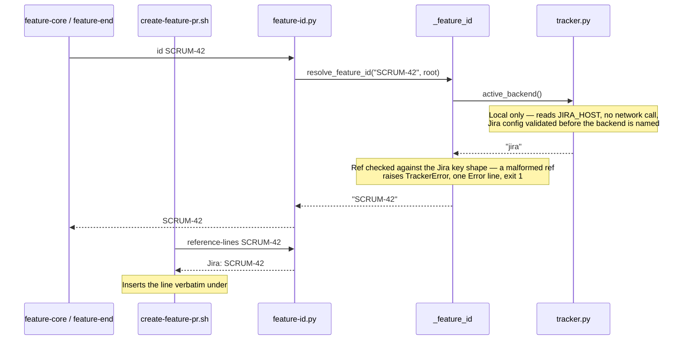
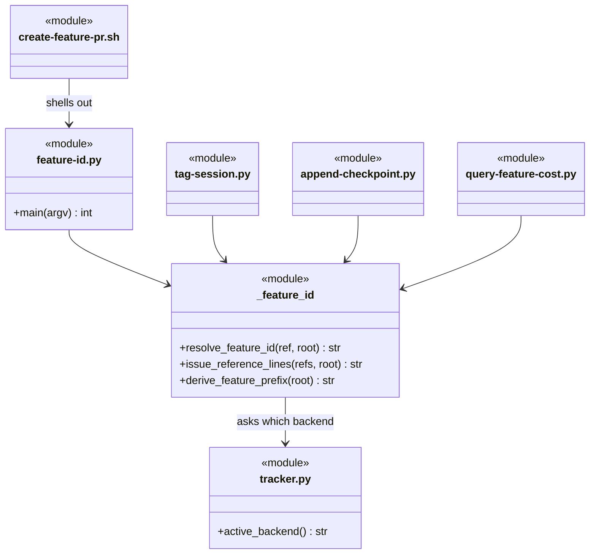
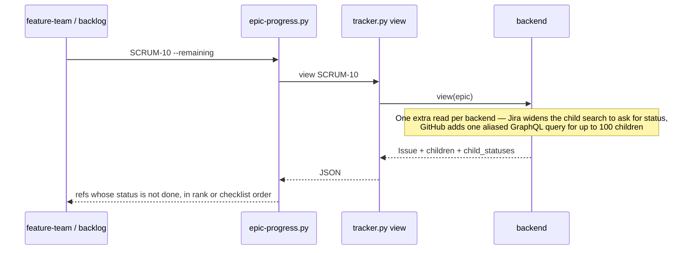
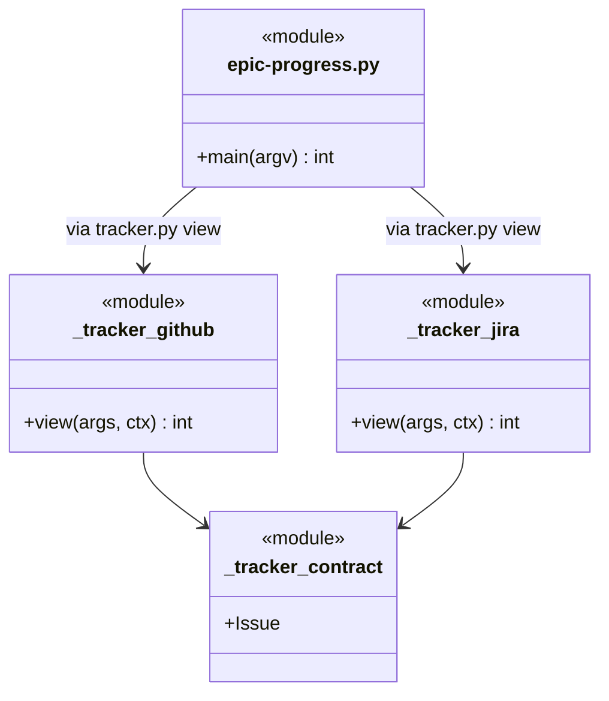
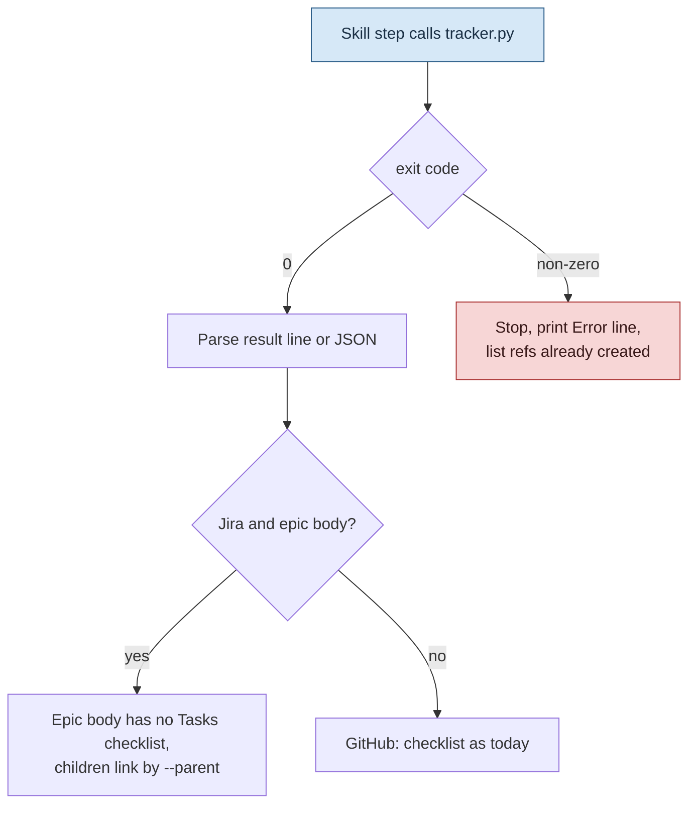
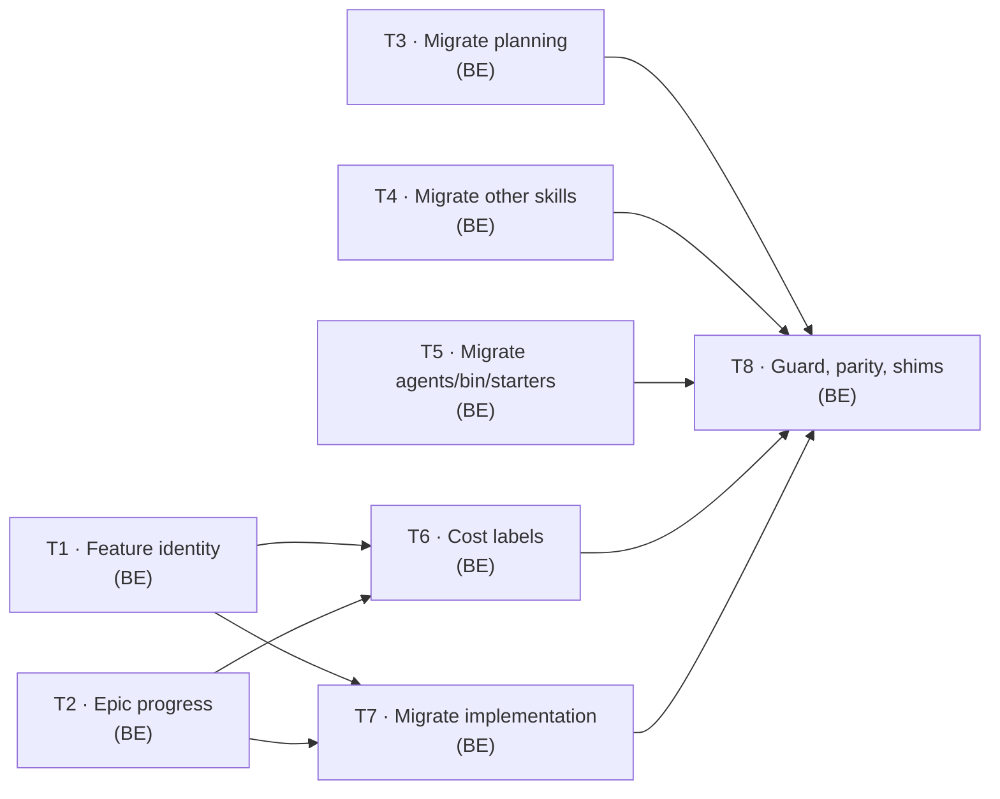

# Low-Level Design: V3 E3.3 — Pipeline on the Tracker Script

## Document Control

| Field | Value |
|-------|-------|
| Version | 0.6 |
| Status | Revised |
| Author | LS / Claude |
| Revised | 2026-11-17 — Issue #150: §1.4 guard tests, repoint scope, removed live-gh dry-run cases |
| Revised | 2026-11-23 — Issue #168: §1.1 Cost labels — zero-cost guard (no labels, explicit line) |
| Revised | 2026-11-17 — Issue #148: §1.1 Cost labels (`_tracker`/`_stale` helpers, best-effort config guard) |
| Revised | 2026-11-17 — Issue #145: §1.3 gh-issue-manager, kickoff epic creation |
| Revised | 2026-11-17 — Issue #147: §1.3 T5 notes |
| Revised | 2026-11-17 — Issue #149: §1.3 T7 notes |
| Created | 2026-11-17 |
| Revised | 2026-11-17 — Issue #144: §1.2 `_child_statuses` signature (no `repo`), shared `_BOARD_FIELDS`, reader error path |
| Epic | [#116](https://github.com/mironyx/engineering-delivery-framework/issues/116) |
| Parent | [v3-design.md](v3-design.md) (v0.4) — [C3.5](v3-design.md#c35-feature-identity-resolver), [C3.6](v3-design.md#c36-epic-progress-reader), [C3.7](v3-design.md#c37-pipeline-call-sites), [C3.8](v3-design.md#c38-issue-access-guard) |
| Requirements | [v3-requirements.md](../../requirements/v3-requirements.md) — Stories 2.1, 2.2, 2.3 |
| Implementation plan | [2026-11-15-v3-implementation-plan.md](../../plans/2026-11-15-v3-implementation-plan.md#epic-e33--pipeline-on-the-tracker-script) |
| ADRs | [ADR-0041](../../adr/0041-tracker-abstraction.md), [ADR-0018](../../adr/0018-epic-task-organisation.md), [ADR-0037](../../adr/0037-incremental-session-logging.md) |
| Depends on | [lld-v3-e3-1-tracker-script.md](lld-v3-e3-1-tracker-script.md) (contract, dispatch), [lld-v3-e3-2-jira-backend.md](lld-v3-e3-2-jira-backend.md) (Jira ACs verified after it) |
| Epic id | `v3-e3-3` |
| Revised | 2026-11-17 — Issue #143: §1.1 resolver signatures and internal decomposition |

---

## Scope and decisions

This epic moves every issue-access call onto `bin/tracker.py`, derives `FEATURE_ID` in one place,
reads epic progress through the tracker, and locks the route with a guard test. No behaviour
changes on GitHub beyond the call route.

**Decided here (closes HLD Open Question 1).** Epic progress reads child statuses from `view`:
the `Issue` JSON gains an eighth key, `child_statuses`. Per-child `view` calls were rejected —
they cost N+1 round-trips on both backends, and neither backend needs them: Jira already runs a
child search (it only needs to ask for `status` too), and GitHub already fetches issues as
GraphQL nodes (the children's states and board columns fit in one aliased query). The change
revises the contract that E3.1 and E3.2 shipped (T2 owns it), including Story 1.3's "seven keys".

**Open questions for the reviewer** (each decided so `/feature` is not blocked):

1. **`list` leaves `child_statuses` empty.** Only `view` fills it, and only `view` output is valid
   input for progress (`epic-progress.py` always calls `view`). `list` already returns `[]` children for
   Jira epics, and fetching statuses per listed epic would reintroduce N+1.
2. **A GitHub checklist ref whose issue no longer exists.** `gh api graphql` exits non-zero when an
   aliased `issue(number:)` does not resolve (the repo already matches `Could not resolve to an Issue`
   in `_fetch_issue`), but `stdout` still carries `data` with `null` for that alias. The backend parses
   `data` when stderr contains only not-found errors, drops the null aliases, and raises for any other
   failure. The dropped ref is reported `unknown` by the reader, counted in the total, not as done.
   Reachable by a checklist line pointing at a deleted or transferred issue, or at a PR number.
3. **Epic "remaining tasks" on GitHub changes meaning slightly.** `/feature-team epic N` used the
   unticked checkboxes; it now uses children whose status is not `done`. They differ only for an
   open issue whose box is ticked (or a closed one left unticked); `close` ticks and closes
   together, so this is rare, and the status-based answer is the correct one.
4. **Cost labels on Jira issues.** `query-feature-cost.py` writes `ai-cost-pr:1.2345`-style labels.
   Jira labels forbid spaces but the colon has not been checked against the API. The `SCRUM`
   smoke run confirms; if rejected, labels move to a comment (follow-up, not this epic).

---

# Part A — Human-Reviewable Design

## 1.1 Feature identity resolver

**Stories:** 2.2 · **Layers:** BE

### Purpose

`FEATURE_ID` is derived four times today — `tag-session.py`, `append-checkpoint.py`,
`query-feature-cost.py` and `create-feature-pr.sh` each carry a copy of the prefix logic. One
module owns it, asks the tracker which backend is active, and also supplies the issue-reference
line for the PR body. Skills stop deriving IDs in prose.

### Behavioural Flows



On GitHub the same calls return `EDF-87` (`<prefix>-<n>`, prefix as today) and `Closes #87`.

### Structural Overview



### Invariants

| # | Invariant | Verification |
|---|-----------|-------------|
| I1 | `FEATURE_ID` is derived only in `_feature_id.py`; the four consumers hold no prefix logic | Grep: `EDF_FEATURE_PREFIX` appears under `bin/` and `skills/` only in `_feature_id.py` and `skills/setup/` |
| I2 | On Jira `EDF_FEATURE_PREFIX` is ignored and `FEATURE_ID` equals the key | Test: prefix set, backend Jira, result is the key |
| I3 | On GitHub the ID and PR body line are as today (`<prefix>-<n>`, `Closes #N`). One deliberate change: the PR script now uses the same prefix derivation as `tag-session.py` (main-checkout directory name, not `gh repo view`), so the PR `FEATURE_ID` always matches the tag | Existing tests pass with only the ref argument type adjusted; new test: directory name ≠ repo name gives the tag-session prefix |
| I4 | The Jira PR body contains `Jira: <key>` and no `Closes #` | Test: dry-run PR body on Jira |
| I5 | The resolver never reads `JIRA_*` itself | Grep: `JIRA_` absent from `_feature_id.py` (I3 of E3.1 stays true) |

### Acceptance Criteria

- [ ] Jira + `SCRUM-42` → `FEATURE_ID=SCRUM-42`, `EDF_FEATURE_PREFIX` unused (2.2 AC1)
- [ ] Session log file name ends `-SCRUM-42.md` (2.2 AC2)
- [ ] Jira PR body has `Jira: SCRUM-42`, no `Closes #` (2.2 AC3)
- [ ] GitHub: ID, PR body and logs unchanged; branch names unchanged on both (2.2 AC6)

### BDD Specs

```text
describe('resolve_feature_id')
  it('returns the key on Jira and ignores EDF_FEATURE_PREFIX')
  it('returns <prefix>-<n> on GitHub for "#87" and "87"')
  it('raises TrackerError for a ref that is not a Jira key on Jira')
describe('consumer failure')
  it('tag-session and append-checkpoint exit 1 with one Error line when the backend config is invalid')
  it('create-feature-pr.sh aborts before creating a PR when feature-id.py exits 1')
describe('issue_reference_lines')
  it('returns "Jira: SCRUM-42" per ref on Jira')
  it('returns "Closes #87" per ref on GitHub')
describe('tag-session / append-checkpoint / query-feature-cost')
  it('use the resolver ID for the tag, the log lookup and the Prometheus label')
describe('query-feature-cost labels (Task 6)')
  it('issue labels: one view and one edit carrying all adds and stale removes, on both backends')
  it('gh label create runs on GitHub only, and PR labels go through the backend helper')
```

### HLD coverage assessment

- C3.5 — sufficient; this section adds the module surface, the CLI and the consumer list.

## 1.2 Epic progress

**Stories:** 2.1 · **Layers:** BE

### Purpose

"How far along is this epic?" for either tracker, without N+1 calls. `view` of an epic returns
each child's status; a small reader formats it and lists what remains.

### Behavioural Flows



On GitHub, `closed` → `done`; otherwise the board column; no board → `todo` (existing
`_derive_status`). On Jira, `_status_of` (existing).

### Structural Overview



### Invariants

| # | Invariant | Verification |
|---|-----------|-------------|
| I6 | `Issue` JSON has exactly the eight keys in declared order, `child_statuses` last; `{}` for non-epics | Update the existing exact-key tests in `test_tracker.py`, `test_tracker_github.py`, `test_tracker_jira.py` |
| I7 | `view` on an epic makes a bounded number of calls independent of child count (GitHub: +1, Jira: +0) | Tests count fake-`gh` and fake-Jira requests for 1 and for 20 children |
| I8 | Every key of `child_statuses` is a member of `children` | Test on both backends |
| I9 | The reader never writes, closes or transitions anything | Test: fake records no write call |

### Acceptance Criteria

- [ ] Epic with three children, one Done → `1 of 3 done`, each child listed with its status (2.1 AC2)
- [ ] GitHub: a checklist ref to a missing issue does not fail `view`; the reader shows it `unknown`
- [ ] Jira `view` of an epic returns `child_statuses` from the existing search (no extra request)
- [ ] GitHub `view` of an epic returns `child_statuses` from one extra GraphQL call
- [ ] `--remaining` lists children not `done`

### BDD Specs

```text
describe('epic-progress.py')
  it('prints "1 of 3 done" and one line per child with its status')
  it('--remaining prints only children whose status is not done')
  it('reports a child missing from child_statuses as unknown, counted in total, not done')
  it('exits non-zero with the tracker Error line when view fails')
describe('view child_statuses')
  it('Jira: maps each child via _status_of, no extra request')
  it('GitHub: one aliased query for N children, closed -> done, board column otherwise')
  it('GitHub: exit 1 with a null alias and not-found stderr -> data parsed, ref omitted; other stderr raises')
  it('non-epic and list results carry {}')
```

### HLD coverage assessment

- C3.6 — extended: HLD said "`view` on each child"; this LLD replaces it with `child_statuses`. v3-design.md Flow 5 and Open Question 1 are patched by T2.

## 1.3 Call-site migration

**Stories:** 2.1, 2.2, 2.3 · **Layers:** BE (skills, agents, bin, starters)

### Purpose

Replace every `gh issue` / `gh project` call and every `gh-create-issue.sh` /
`gh-project-status.sh` / `check-epic-checkbox.py` reference with `tracker.py`, in several PRs by
pipeline area. Refs are opaque strings (`#123`, `SCRUM-123`) — never integers, never
concatenated with `#`.

### Behavioural Flows



`/feature-end` calls `close <ref>` once, after `gh pr merge` succeeds; a failed merge stops before it
(Story 2.2 AC4/AC5). `/feature` selects the first of `list --status todo --label kind:task` and
stops with `No Todo items` when the list is empty, before creating a branch (Story 2.3 AC4).
Closing a child never touches its epic on Jira (2.1 AC3).

### Invariants

| # | Invariant | Verification |
|---|-----------|-------------|
| I10 | No file under `skills/`, `agents/`, `bin/`, `starters/` outside `_tracker_github.py` matches an issue-access pattern | The guard test (§1.4) |

### Acceptance Criteria

- [ ] Jira: `/architect` creates epic (`--type epic`) and tasks (`--parent`), no GitHub issue (2.1 AC1, 2.3 AC2)
- [ ] Jira: `/feature` picks the top `todo` task, sets `in progress`, reads the body via `view` (2.3 AC3)
- [ ] Jira: `/feature-end` moves the task to Done on merge, epic unchanged; not on a failed merge (2.2 AC4/AC5, 2.1 AC3)
- [ ] Non-zero tracker exit stops the skill and reports refs created so far (2.3 AC5)
- [ ] Jira: `/backlog` lists `SCRUM-<n>` refs (2.3 AC6)
- [ ] GitHub: `/architect`, `/feature`, `/backlog` behave as today (2.3 AC7, 2.1 AC4)

### BDD Specs

Skills are prose, so the executable checks are the guard test (§1.4) and the manual `/qa` run on
`SCRUM` (epic exit criterion). Mechanical checks per migration PR:

```text
describe('migrated skill files')
  it('contain no gh issue / gh project / gh-create-issue / gh-project-status / check-epic-checkbox')
  it('invoke tracker.py through hooks/run-python.sh with ${CLAUDE_PLUGIN_ROOT} paths')
describe('create-feature-pr.sh')
  it('--dry-run on GitHub prints the unchanged body (Closes #N)')
  it('--dry-run on Jira prints Jira: <key> and no Closes #')
```

### HLD coverage assessment

- C3.7 — sufficient for intent; this section adds the substitution table (Part B) and the area split.

## 1.4 Issue-access guard and shim removal

**Stories:** 2.3 · **Layers:** BE (tests)

### Purpose

A test fails, naming file and line, when issue access re-enters outside the GitHub backend. It
lands last; then the parity tests move to the tracker's GitHub backend and the E3.1 shims go.

### Invariants

| # | Invariant | Verification |
|---|-----------|-------------|
| I13 | The guard scans `skills/`, `agents/`, `bin/`, `starters/` and excludes only `bin/_tracker_github.py` | The test's own exclusion list is asserted to equal that one path |
| I14 | The guard catches the shell form, the argv form, `gh api …/issues…` in shell and argv form, and the three shim names | Table-driven test over a synthetic tree (one violation per pattern, plus clean files). Wrapper calls such as `_gh(["issue", …])` are out of scope |
| I15 | After removal no `gh-create-issue.sh`, `gh-project-status.sh` or `check-epic-checkbox.py` exists and no file under the scanned roots, `README.md` or `tracker.py` names them | Guard shim-name patterns over the scanned roots; test asserts `README.md` and `tracker.py` contain none |

### Acceptance Criteria

- [ ] Guard fails with `path:line` on each violating pattern (2.3 AC1)
- [ ] Parity tests in `test_shell_scripts.py` / `test_utils.py` drive `tracker.py` with the same expected output
- [ ] Shims and `check-epic-checkbox.py` removed; `test_tracker_github.py` unchanged except removal of its shim cases

### BDD Specs

```text
describe('issue-access guard')
  it('fails naming file:line for "gh issue" in a skill')
  it('fails for the argv form ["gh", "issue"] in a bin script')
  it('fails for gh api repos/{owner}/{repo}/issues/... in shell form and in argv form')
  it('fails for a reference to gh-create-issue, gh-project-status or check-epic-checkbox')
  it('ignores gh pr and gh api paths without /issues')
  it('passes on the real tree with only _tracker_github.py excluded')
```

### HLD coverage assessment

- C3.8 — sufficient, referenced only.

---

# Part B — Agent Implementation Detail

## External Surfaces

| Surface | Version / revision | Doc URL | Verified | New to repo |
|---------|--------------------|---------|----------|-------------|
| GitHub GraphQL API, aliased `issue(number:)` fields in one query | v4 (unversioned, current) | https://docs.github.com/en/graphql/guides/forming-calls-with-graphql | Unverified | No — `_tracker_github.py` already calls `gh api graphql` |
| Jira Cloud REST v3 search (`status` field on children) | REST v3, as pinned in E3.2 | https://developer.atlassian.com/cloud/jira/platform/rest/v3/api-group-issue-search/ | Yes — via E3.2 | No — `_search_all` exists |
| Jira labels (colon in a label) | REST v3 | https://support.atlassian.com/jira-software-cloud/docs/what-are-issue-labels/ | Unverified | No |

> **Unverified — recall-based:** several `alias: issue(number: N) { … }` fields in one GraphQL
> `repository` selection are valid; a missing issue yields `null` for its alias **and a non-zero `gh`
> exit** (matching the existing `_fetch_issue` handling of `Could not resolve to an Issue`). The
> implementer confirms both against the doc above and adds a `fake_gh` case (exit 1 + partial `data`).

## Reused helpers — DO NOT re-implement

| Helper | Path | Replaces |
|--------|------|----------|
| `_derive_status(node, board)` | `bin/_tracker_github.py` | Any new GitHub status mapping |
| `_status_of(fields)` | `bin/_tracker_jira.py` | Any new Jira status mapping |
| `_search_all(client, jql, fields=, limit=)` | `bin/_tracker_jira.py` | A second child search |
| `ISSUE_FIELDS` / `load_board` / `_board_item` | `bin/_tracker_github.py` | Hand-written projectItems parsing |
| `_edf_env.resolve(key, root)` | `bin/_edf_env.py` | Reading `.env` directly |
| `issue_json(...)` | `bin/_tracker_contract.py` | Hand-built JSON |
| `fake_gh`, `fake_jira` fixtures | `tests/conftest.py` | New stubs (respx exception per ADR-0041) |

<a id="LLD-v3-e3-3-feature-identity"></a>

## 1.1 Feature identity resolver — Implementation

#### File structure

```text
plugins/edf/bin/
  _feature_id.py        — resolver module (new)
  feature-id.py         — CLI: `id <ref>` and `reference-lines <ref>...` (new)
  tracker.py            — add public active_backend(env_root) (small)
  tag-session.py        — use resolver; `issue` arg is an opaque ref
  append-checkpoint.py  — use resolver; --issue is a ref string
  create-feature-pr.sh  — FEATURE_ID and Issue lines from feature-id.py
tests/
  test_feature_id.py    — resolver and CLI (new)
```

#### Function signatures

```python
# _feature_id.py
def main_checkout_root() -> pathlib.Path: ...                   # parent of the common .git dir; TrackerError outside git
def derive_feature_prefix(root: pathlib.Path) -> str: ...      # moved verbatim from tag-session.py
def resolve_feature_id(ref: str, root: pathlib.Path) -> str:
    """Jira: the key, upper-cased — any `KEY-n` shape. The resolver never reads Jira settings, so it
    cannot check the space; the backend does that on first use. A test compares sample refs, e.g.
    'scrum-42', against `_tracker_jira._parse_ref`. GitHub: f"{prefix}-{digits}" from '#87' or '87'.
    Raises TrackerError on a ref of the wrong shape for the active backend."""
def issue_reference_lines(refs: list[str], root: pathlib.Path) -> str:
    """Jira: 'Jira: KEY' per ref. GitHub: 'Closes #N' per ref (bare or '#'-prefixed input)."""

# tracker.py (new public)
def active_backend(env_root: pathlib.Path) -> str:
    """'github' | 'jira' — exactly what `tracker.py tracker` prints; same validation, no network.
    The resolver passes its own `root`, so the backend and the prefix read the same `.env`."""
```

`feature-id.py` exits 1 with one `Error: …` line on `TrackerError`.

#### Internal decomposition

- `tag-session.py` and `append-checkpoint.py`: delete their `git_root()` copies and use `_feature_id.main_checkout_root()`. `query-feature-cost.py` keeps its own `git_root()` and takes only the prefix from `_feature_id.derive_feature_prefix` (its `--issue` stays an int until Task 6).
- `tag-session.py`: delete `derive_feature_prefix`; `feature_id = resolve_feature_id(args.issue, root)`. `issue` stays positional but is a ref string. `find_session_jsonl(claude_dir, feature_id, issue_number)` searches `{feature_id}` plus `f"issue #{n}"` when `issue_number` (a GitHub number) is given (Jira teammate prompts say `issue SCRUM-42`, which `feature_id` already matches).
- `append-checkpoint.py`: delete its copy; `--issue` loses `type=int`; log lookup and the Prometheus query use `resolve_feature_id`.
- `create-feature-pr.sh`: replace lines 72–84 with `FEATURE_ID=$(… feature-id.py id "$ISSUE")` and `CLOSES_LINES=$(… feature-id.py reference-lines "${ISSUES[@]}")` (variable renamed `ISSUE_LINES`). `--issue` accepts opaque refs; no integer check.

#### Error handling

Malformed ref or invalid backend config → `Error: …` on stderr, exit 1, in `feature-id.py`, `tag-session.py` and
`append-checkpoint.py` — a configuration error is surfaced, not masked (the earlier tracker calls in the same
run would already have failed on it). `create-feature-pr.sh` aborts before `gh pr create` if `feature-id.py` fails.

### Cost labels — `query-feature-cost.py` (Task 6)

Depends on §1.1. The file derives the ID through `_feature_id` (its `_derive_feature_prefix` is deleted) and
`--issue` becomes a ref string. Issue labels go through the tracker in **one** call per run:
`tracker.py view <ref>` → `labels`, then a single `tracker.py edit <ref> --remove-label … --add-label …` carrying
all three new labels and every stale one. `gh label create` runs on GitHub only (Jira labels are free-form).
PR labels move into the GitHub backend — a GitHub-only operation, so it belongs there and the guard exempts it:

```python
# _tracker_github.py (new public)
def set_pr_labels(pr: int, add: list[str], remove: list[str]) -> None:
    """Existing REST calls, moved verbatim: DELETE/POST repos/{owner}/{repo}/issues/{pr}/labels.
    Best-effort — failures are swallowed as today."""
```

`query-feature-cost.py` imports it. `gh pr edit --add-label` is deliberately not used: it has a reported failure on some
`gh` versions (cli/cli#11983) that would silently drop the labels.
Tests: new `tests/test_query_feature_cost.py` on `fake_gh` / `fake_jira` — stale-label removal and the single `edit`
call on both backends, GitHub-only `label create`, PR-label route, Jira run makes no `gh` call.
Failure policy is unchanged: best-effort, output suppressed, never blocks the PR — including a bad backend
configuration, which makes `apply_labels` return without labelling (the PR-label JSON parse is guarded the same way).
**Zero cost** (Issue #168): when `query_metrics` returns `cost == 0` — sessions are tagged but Prometheus holds no
usage for them — `main` prints `- No Prometheus data for <ID> (cost 0) — labels not applied` under the usual
`## [Final ]Usage` heading and skips `apply_labels`, so no `ai-cost-*:0.0000` label is written. Non-zero cost is unchanged.
Internals: `_tracker(*args)` runs `tracker.py` as a subprocess; `_stale(existing, new)` picks same-prefix labels that
differ from the new ones and serves both the issue (`view` labels) and the PR (`gh pr view` labels) side.
`set_pr_labels` takes the caller-computed `remove` list; it never reads labels itself.

<a id="LLD-v3-e3-3-epic-progress"></a>

## 1.2 Epic progress — Implementation

#### File structure

```text
plugins/edf/bin/
  _tracker_contract.py  — Issue.child_statuses: dict[str, str] (8th field, default factory dict)
  _tracker_github.py    — _child_statuses(children, board); view fills it; _to_issue defaults {}
                          (set_pr_labels() lands later, in Task 6)
  _tracker_jira.py      — view requests status on the child search; _to_issue defaults {}
  epic-progress.py      — CLI reader (new)
tests/
  test_tracker.py, test_tracker_github.py, test_tracker_jira.py — update exact-key tests, add cases
  test_epic_progress.py — reader (new)
plugins/edf/docs/ — v3-design.md Flow 5 + Open Question 1, v3-requirements.md Story 1.3 AC1,
                    lld-v3-e3-1/-e3-2 revision rows (this task)
```

#### Function signatures

```python
# _tracker_contract.py
@dataclass(frozen=True)
class Issue:
    ref: str; title: str; body: str; labels: list[str]; status: str
    parent: str | None; children: list[str]
    child_statuses: dict[str, str] = field(default_factory=dict)   # ref -> status; keys ⊆ children

# _tracker_github.py
_BOARD_FIELDS = "projectItems(first:10){nodes{id project{id} fieldValues(first:20){nodes{…}}}}"
    # shared: ISSUE_FIELDS = _BASE_FIELDS + " " + _BOARD_FIELDS; a child selects "state" plus _BOARD_FIELDS
    # only when a board is configured — no body, labels or comments
def _child_statuses(children: list[str], board: Board | None) -> dict[str, str]:
    """One `gh api graphql` call ({owner}/{repo} placeholders): aliases c0..cN = issue(number: N){…},
    read back as data.repository.c<i>. null node -> omitted.
    Status via _derive_status. Empty children -> {} with no call. Children beyond the first 100 are not
    queried, matching Jira's cap and `list`."""

# _tracker_jira.py  (inside view)
#   _search_all(client, jql, fields=["summary", "status"], limit=100)
#   children = [i["key"] ...]; child_statuses = {i["key"]: _status_of(i["fields"]) ...}

# epic-progress.py
def main(argv: list[str] | None = None) -> int
#   epic-progress.py REF            -> "<REF>: 1 of 3 done" then "  <child> <status>" per child
#   epic-progress.py REF --remaining-> children whose status != done, one ref per line
```

> **Constraint:** `epic-progress.py` calls `tracker.py view` as a subprocess (the only route to credentials, I3 of E3.1) and never imports a backend.

> **Constraint:** list results keep `child_statuses == {}` (open question 1). The key is still present, so the eight-key shape holds for every `Issue`.

#### Error handling

`tracker.py view` non-zero → the reader prints the tracker's `Error:` line and exits 1; unparseable `view` output
prints `Error: unexpected tracker view output` and exits 1. In `_child_statuses`, on a
non-zero `gh` exit: parse `data` and drop null aliases if every non-empty stderr line contains the existing
`_NOT_FOUND` marker; otherwise raise `TrackerError("gh api graphql failed: …")` as `view` does today.

<a id="LLD-v3-e3-3-call-site-migration"></a>

## 1.3 Call-site migration — Implementation

**Invocation (the one form to use in skills):**
`bash ${CLAUDE_PLUGIN_ROOT}/hooks/run-python.sh ${CLAUDE_PLUGIN_ROOT}/bin/tracker.py <op> …`

#### Substitution table

| Old | New |
|-----|-----|
| `gh issue view N --json title,body,labels` | `tracker.py view <ref>` → JSON (`title`, `body`, `labels`, `status`, `parent`, `children`, `child_statuses`) |
| `gh issue view N --json state` | `view <ref>` and test `status == done` |
| `gh issue list …` / `gh project item-list …` | `tracker.py list [--status S] [--label L]` |
| `gh issue create` / `gh-create-issue.sh` | `tracker.py create --title … --body … [--labels …] [--type epic] [--parent <ref>]` |
| `gh issue edit` | `tracker.py edit <ref> [--body …] [--add-label …] [--remove-label …]` |
| `gh issue comment` | `tracker.py comment <ref> --body …` |
| `gh-project-status.sh add N "in progress"` / `… N done` | `tracker.py status <ref> "in progress"` (add `--add-to-board` where the script used `add`) |
| `gh issue close N` + `check-epic-checkbox.py` | `tracker.py close <ref>` — only after a successful merge |
| epic task checklist parsing | `epic-progress.py <epic> --remaining` |

Rules for every migrated file: refs are opaque; a bare number from GitHub `created:<n>` is rendered `#<n>`
only when the value is all digits; multi-create flows keep the list of `created:`/`exists:` lines and, on any
non-zero exit, stop and print them; `/feature` on an empty `list` prints `No Todo items` and stops before a branch.

#### Area split (disjoint files)

| Task | Files |
|------|-------|
| T3 planning | `skills/kickoff/*`, `skills/architect/*`, `agents/gh-issue-manager.md` |
| T4 other skills | `skills/{bug,backlog,baseline,create-plan,frontend-architect,lld,lld-sync,pr-review,refactor-architect,requirements,retro,setup}/*` |
| T5 bin, agents, starters | `agents/{feature-evaluator,test-author}.md`, `bin/brief-package.sh`, `bin/update-coverage-manifest.py`, `starters/CLAUDE.md.template` |

T5 as built: `brief-package.sh` reads the issue with one `tracker.py view` call (title, body and ref from the JSON), so `--issue` takes any ref and the leading `#` is stripped before it is used in the `.edf/brief-<ref>.md` file name. `update-coverage-manifest.py --extract-epic-slug` accepts the `view` JSON on stdin as well as a bare body, so T7 pipes `tracker.py view <ref>` straight into it.
| T7 implementation | `skills/feature/*`, `skills/feature-core/*`, `skills/feature-end/*`, `skills/feature-team/*` (SKILL.md and flowchart.md each; their `FEATURE_ID` derivation text → `feature-id.py id <ref>`) |

T7 as built: `/feature` takes the first ref of `list --status todo --label kind:task` and stops with `No Todo items` before any branch exists; its `epic <ref>` mode and `/feature-team epic <ref>` read remaining tasks from `epic-progress.py --remaining`. `/feature-end` finds its PR by searching the body for the `feature-id.py reference-lines <ref>` line (`Closes #N` or `Jira: KEY`), not for `closes #N`, and calls `close <ref>` once, in the cleanup chain that runs only after the merge state is `MERGED`. `/feature-team` closes a finished epic with `comment` then `close`.

`bin/query-feature-cost.py` and `create-feature-pr.sh` are not call-site migrations: Tasks 6 and 1 own them.

#### `gh-issue-manager` agent (Task 3)

Detects the backend with `tracker.py tracker`. Task creation passes `--parent <epic-ref>` on Jira; epic body
edit uses `tracker.py edit <epic> --body`. On Jira the `### Tasks` checklist is dropped from `epic_body` (children
link by `parent`, ADR-0018 revision); the dependency graph and waves table keep their substituted refs. On
GitHub the checklist and `#N` substitution are unchanged. Model stays `haiku` (mechanical).
The agent shows two literal `create` commands (GitHub, and Jira with `--parent`) and runs one, because a `haiku` agent copies a bracketed optional flag verbatim. `kickoff` creates epics with `--type epic` and no `epic` in `--labels` (the backend adds the label); its epic stub's `## Tasks` line is marked GitHub-only. The coverage-manifest backfill in `architect` writes the returned ref (`#N` or a Jira key) into `issue:`.

> **Constraint:** Skills prose stays backend-agnostic: no `if Jira` branches in skills beyond the two the HLD
> names (epic body checklist in `gh-issue-manager`/`architect`, and the Jira PR line, which `create-feature-pr.sh` owns).

<a id="LLD-v3-e3-3-guard-and-shims"></a>

## 1.4 Issue-access guard and shim removal — Implementation

#### File structure

```text
tests/
  test_issue_access_guard.py — the guard (new)
  test_shell_scripts.py, test_utils.py — repointed at tracker.py / the GitHub backend helpers, same expected output
  test_tracker_github.py — shim cases dropped: CREATE_SHIM / STATUS_SHIM / EPIC_SHIM, TestShims, the shim half of the golden matrix
plugins/edf/bin/ — delete gh-create-issue.sh, gh-project-status.sh, check-epic-checkbox.py
  (parse-project-item-id.py stays: it parses project items, is not issue access, and test_parsers.py uses it)
```

#### Function signatures

```python
ROOTS = ["skills", "agents", "bin", "starters"]          # under plugins/edf
EXCLUDED = {"bin/_tracker_github.py"}
PATTERNS = [r"gh\s+issue\b", r"gh\s+project\b",
            r"[\"']gh[\"']\s*,\s*[\"'](issue|project)[\"']",
            r"gh\s+api\b[^\n]*/issues\b",
            r"[\"']gh[\"']\s*,\s*[\"']api[\"'][^\]\n]*/issues\b",
            r"gh-create-issue|gh-project-status|check-epic-checkbox"]
def scan(root: pathlib.Path) -> list[str]:               # ["relpath:line", ...]
def test_no_issue_access_outside_github_backend() -> None
def test_exclusion_list_is_only_the_github_backend() -> None
def test_shims_are_gone_and_unreferenced() -> None        # shims absent; README.md (outside the roots) names none
```

> **Implementation note (issue #150):** the two live-`gh` dry-run cases in `test_shell_scripts.py` were removed, not
> repointed: against a real repo `create` dedupes onto an existing issue, so they are not reproducible. The
> `create-dry-run*` goldens cover the output hermetically. `test_cross_references.py` needed no change.

> **Constraint:** `plugins/edf/docs/` and `CLAUDE.md` are not scanned (they describe the rule). Prose mentions of
> "gh issue" inside migrated skills must be reworded, not excluded.

#### Order of operations (Task 8)

1. Add the guard and make it pass (all prior tasks merged). 2. Repoint parity tests. 3. Delete shims and
`check-epic-checkbox.py`; remove their references (`README.md`, the `tracker.py` docstrings, `test_cross_references.py`,
`kb/` and `CLAUDE.md` if they name the shims).

---

## Cross-References

### Internal

- §1.1 depends on: —
- §1.2 depends on: —
- §1.3 depends on: [§1.1](#LLD-v3-e3-3-feature-identity) (Task 7 only), [§1.2](#LLD-v3-e3-3-epic-progress) (Task 7 only)
- §1.4 depends on: §1.3 complete, and §1.1 Cost labels (Task 6)

### External

- Depends on: [E3.1 LLD](lld-v3-e3-1-tracker-script.md), [E3.2 LLD](lld-v3-e3-2-jira-backend.md)
- Revises: E3.1/E3.2 contract (`Issue` eighth key), Story 1.3 AC1, HLD C3.6, Flow 5 and Open Question 1

### Shared types

`Issue` (`_tracker_contract.py`) — gains `child_statuses`; consumed by both backends and `epic-progress.py`.

## kb/ additions

Add to `plugins/edf/kb/architecture.md` (reusable helpers):

```markdown
### Feature identity and epic progress

- `bin/_feature_id.py` — `resolve_feature_id(ref, root)`, `issue_reference_lines(refs, root)`. The only place
  `FEATURE_ID` and the PR issue line are derived. Do not read `EDF_FEATURE_PREFIX` elsewhere.
- `bin/epic-progress.py <epic> [--remaining]` — epic progress from `tracker.py view` (`child_statuses`).
  Do not parse epic checklists.
- Exception to "all issue operations go through `bin/tracker.py`": `_tracker_github.set_pr_labels` (a GitHub-only
  PR-label operation) is imported directly by `query-feature-cost.py`. No other direct backend import is allowed.
```

---

## Tasks

Every task that changes skills, agents, bin or hooks also bumps the patch version in `plugins/edf/.claude-plugin/plugin.json`
and `.claude-plugin/marketplace.json` (kept in sync) and updates README counts if files are added or removed
(CLAUDE.md convention). Parallel PRs in one wave all edit those two lines — the later merge rebases and re-bumps.

### Task 1: Feature identity resolver

**Issue title:** Feature identity resolver and consumers
**Layer:** BE
**Depends on:** —
**Stories:** 2.2
**HLD reference:** [C3.5](v3-design.md#c35-feature-identity-resolver)

**What:** Add `_feature_id.py`, `feature-id.py` and `tracker.active_backend(env_root)`; move `tag-session`, `append-checkpoint` and `create-feature-pr.sh` onto them.

**Acceptance criteria:**
- [ ] Jira → `FEATURE_ID=<key>`, prefix ignored; GitHub as today
- [ ] PR body line: `Jira: <key>` / `Closes #N`; PR `FEATURE_ID` uses the tag-session prefix
- [ ] No `EDF_FEATURE_PREFIX` read in `bin/` outside `_feature_id.py`
- [ ] Invalid backend config → one `Error:` line, exit 1; `create-feature-pr.sh` creates no PR

**BDD specs:** see §1.1.

**Files to create/modify:**
- `plugins/edf/bin/_feature_id.py`, `feature-id.py` (new); `tracker.py`, `tag-session.py`, `append-checkpoint.py`, `create-feature-pr.sh`
- `tests/test_feature_id.py` (new; `TestDeriveFeaturePrefix` moves here from `test_utils.py`); `tests/test_tag_session.py`, `test_append_checkpoint.py`, `test_shell_scripts.py` (the `create-feature-pr.sh` cases) adjusted only for the opaque-ref argument type

### Task 2: Epic progress (`child_statuses` + reader)

**Issue title:** Epic progress: child statuses in view and reader
**Layer:** BE
**Depends on:** —
**Stories:** 2.1
**HLD reference:** [C3.6](v3-design.md#c36-epic-progress-reader)

**What:** Add `Issue.child_statuses`; fill it in both backends' `view` without per-child calls; add `epic-progress.py`; revise Story 1.3, HLD Flow 5/Open Question 1/C3.6 and the E3.1/E3.2 LLD revision rows.

**Acceptance criteria:**
- [ ] Eight-key JSON on every `view`/`list`, `child_statuses` last, `{}` for non-epics and `list`
- [ ] Jira +0 requests, GitHub +1 request regardless of child count (≤ 100)
- [ ] GitHub: a missing checklist issue does not fail `view`; the reader shows it `unknown`
- [ ] `epic-progress.py` prints `1 of 3 done` and per-child statuses; `--remaining` lists non-done children
- [ ] Docs revised in the same PR (HLD C3.6 updated to the status-based GitHub progress, not just noted)

**BDD specs:** see §1.2.

**Files to create/modify:**
- `plugins/edf/bin/_tracker_contract.py`, `_tracker_github.py`, `_tracker_jira.py`, `epic-progress.py` (new)
- `tests/test_tracker*.py` (exact-key updates + new cases), `tests/test_epic_progress.py` (new)
- `plugins/edf/docs/requirements/v3-requirements.md`, `design/v3/v3-design.md`, `lld-v3-e3-1-tracker-script.md`, `lld-v3-e3-2-jira-backend.md`

### Task 3: Migrate planning call sites

**Issue title:** Migrate planning skills and gh-issue-manager to the tracker script
**Layer:** BE
**Depends on:** —
**Stories:** 2.1, 2.3
**HLD reference:** [C3.7](v3-design.md#c37-pipeline-call-sites)

**What:** Apply the §1.3 substitution table to `kickoff`, `architect` (SKILL.md + flowcharts) and the `gh-issue-manager` agent, including the Jira no-checklist epic body.

**Acceptance criteria:**
- [ ] Epics created with `--type epic`, tasks with `--parent` (Jira)
- [ ] No `gh issue`, `gh project`, `gh-create-issue.sh`, `gh-project-status.sh` in these files
- [ ] GitHub epic body checklist behaviour unchanged

**BDD specs:** see §1.3.

**Files to create/modify:**
- `plugins/edf/skills/kickoff/{SKILL,flowchart}.md`, `skills/architect/{SKILL,flowchart}.md`, `agents/gh-issue-manager.md`

### Task 4: Migrate remaining skills

**Issue title:** Migrate remaining skills to the tracker script
**Layer:** BE
**Depends on:** —
**Stories:** 2.3
**HLD reference:** [C3.7](v3-design.md#c37-pipeline-call-sites)

**What:** Apply §1.3 to `bug`, `backlog`, `baseline`, `create-plan`, `frontend-architect`, `lld`, `lld-sync`, `pr-review`, `refactor-architect`, `requirements`, `retro`, `setup` and their flowcharts.

**Acceptance criteria:**
- [ ] `/backlog` lists issues by tracker ref on Jira
- [ ] No issue-access patterns left in these files

**BDD specs:** see §1.3.

**Files to create/modify:**
- `plugins/edf/skills/{bug,backlog,baseline,create-plan,frontend-architect,lld,lld-sync,pr-review,refactor-architect,requirements,retro,setup}/*`

### Task 5: Migrate agents, bin scripts and starters

**Issue title:** Migrate agents, bin scripts and starters template to the tracker script
**Layer:** BE
**Depends on:** —
**Stories:** 2.3
**HLD reference:** [C3.7](v3-design.md#c37-pipeline-call-sites)

**What:** Apply §1.3 to `feature-evaluator`, `test-author`, `brief-package.sh`, `update-coverage-manifest.py` and `starters/CLAUDE.md.template`.

**Acceptance criteria:**
- [ ] No issue-access patterns left in these files
- [ ] Existing tests for the two scripts pass; `brief-package.sh` and the manifest updater work on GitHub as today

**BDD specs:** see §1.3.

**Files to create/modify:**
- `plugins/edf/agents/{feature-evaluator,test-author}.md`, `bin/brief-package.sh`, `bin/update-coverage-manifest.py`, `starters/CLAUDE.md.template`
- `tests/test_shell_scripts.py` (the `brief-package.sh` fake-`gh` cases) — shared with Task 1; whichever merges second rebases

### Task 6: Cost labels through the tracker

**Issue title:** Route cost labels through the tracker and GitHub backend
**Layer:** BE
**Depends on:** Task 1, Task 2
**Stories:** 2.2, 2.3
**HLD reference:** [C3.5](v3-design.md#c35-feature-identity-resolver)

**What:** Migrate `query-feature-cost.py` per §1.1 "Cost labels": resolver for the ID, one `view` + one `edit` for issue labels, PR labels via `_tracker_github.set_pr_labels`.

**Acceptance criteria:**
- [ ] No `gh issue` and no `gh api …/issues` left in `query-feature-cost.py`
- [ ] One `tracker.py edit` call per run carries all adds and removes; `gh label create` on GitHub only
- [ ] PR labels unchanged on GitHub

**BDD specs:** see §1.1 Cost labels.

**Files to create/modify:**
- `plugins/edf/bin/query-feature-cost.py`, `_tracker_github.py` (`set_pr_labels`), `tests/test_query_feature_cost.py` (new)

### Task 7: Migrate implementation skills

**Issue title:** Migrate feature, feature-core, feature-end and feature-team to the tracker script
**Layer:** BE
**Depends on:** Task 1, Task 2
**Stories:** 2.1, 2.2, 2.3
**HLD reference:** [C3.7](v3-design.md#c37-pipeline-call-sites)

**What:** Apply §1.3 to the four implementation skills and their flowcharts; `FEATURE_ID` comes from `feature-id.py id <ref>`; `/feature-end` calls `close <ref>` once, only after a successful merge; `/feature-team epic N` reads remaining tasks from `epic-progress.py --remaining`.

**Acceptance criteria:**
- [ ] `/feature` picks the first `list --status todo --label kind:task`, stops with `No Todo items` before creating a branch
- [ ] `/feature-end` calls `close` after merge success only; epic untouched on Jira
- [ ] No issue-access patterns or `EDF_FEATURE_PREFIX` left in these files

**BDD specs:** see §1.3.

**Files to create/modify:**
- `plugins/edf/skills/{feature,feature-core,feature-end,feature-team}/{SKILL,flowchart}.md`

### Task 8: Guard test, parity repoint and shim removal

**Issue title:** Issue-access guard test, parity-test repoint and shim removal
**Layer:** BE
**Depends on:** Task 3, Task 4, Task 5, Task 6, Task 7
**Stories:** 2.3
**HLD reference:** [C3.8](v3-design.md#c38-issue-access-guard)

**What:** Add the guard (§1.4), repoint `test_shell_scripts.py` / `test_utils.py` at `tracker.py`, drop shim cases from `test_tracker_github.py`, delete the E3.1 shims and `check-epic-checkbox.py`.

**Acceptance criteria:**
- [ ] Guard passes with only `_tracker_github.py` excluded; fails with `file:line` per pattern
- [ ] Parity tests keep their expected output
- [ ] Shims and `check-epic-checkbox.py` gone; no references in scanned roots, `README.md` or `tracker.py`
- [ ] `test_tracker_github.py` unchanged except removal of shim cases

**BDD specs:** see §1.4.

**Files to create/modify:**
- `tests/test_issue_access_guard.py` (new), `tests/test_shell_scripts.py`, `tests/test_utils.py`, `tests/test_tracker_github.py`, `tests/test_cross_references.py`
- delete `plugins/edf/bin/gh-create-issue.sh`, `gh-project-status.sh`, `check-epic-checkbox.py`; update `README.md`, `bin/tracker.py` docstrings

---

## Execution Order

### Dependency DAG



### Execution Waves

| Wave | Tasks | Blocked by | Notes |
|------|-------|------------|-------|
| 1 | Task 1, Task 2, Task 3, Task 4, Task 5 | — | Disjoint source files: T1 identity consumers in `bin/`, T2 backends, contract and docs, T3 planning skills, T4 other skills, T5 agents/bin/starters. T1 and T5 both touch `tests/test_shell_scripts.py` in different test classes — rebase on merge |
| 2 | Task 6, Task 7 | Wave 1 (Tasks 1, 2) | T6 edits `query-feature-cost.py` and `_tracker_github.py` (after T2 merged), T7 the four implementation skills — disjoint |
| 3 | Task 8 | Wave 1 (Tasks 3, 4, 5), Wave 2 (Tasks 6, 7) | Guard needs every call site migrated |

T1 edits `tracker.py` (additive); T2 edits the `_tracker_*.py` backends — no overlap. E3.4 edits `skills/setup/*`, which Task 4 also edits: land whichever merges first and rebase the other.
