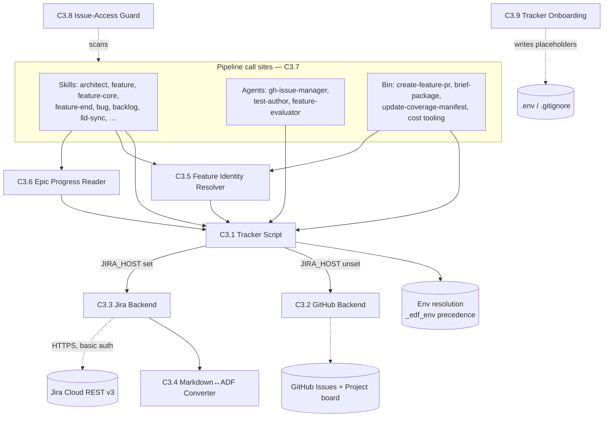
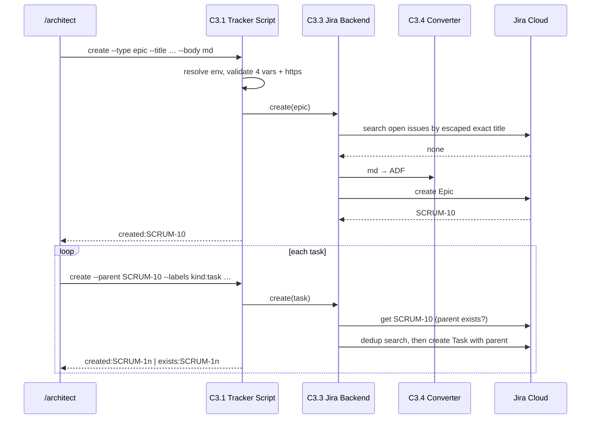
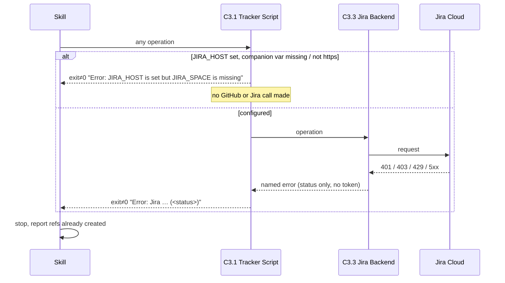

# V3 High-Level Design — Jira Issue Tracker (Delta)

## Document Control

| Field | Value |
|-------|-------|
| Version | 0.4 |
| Status | Draft — awaiting Gate 1 |
| Author | LS / Claude |
| Created | 2026-11-14 |
| Last updated | 2026-11-15 |
| Requirements | [v3-requirements.md](../../requirements/v3-requirements.md) (v1.0) |
| Mode | Delta against [v1 HLD](../v1/v1-design.md) |

## Change Log

| Version | Date | Author | Changes |
|---------|------|--------|---------|
| 0.4 | 2026-11-15 | LS / Claude | Gate 1 drift fixes: `close` operation (GitHub board Done + issue close + epic tick; Jira → Done) so `status` keeps `gh-project-status.sh` parity; GitHub `parent`/`children` source and `--type epic` label; parent-not-found error form; `tracker` is local-only; `starters/` brought into C3.7/C3.8 scope; Performance bullet; injection rule on GitHub side; `close` idempotent, in today's step order |
| 0.3 | 2026-11-15 | LS / Claude | Pre-Gate 1 tidy: Flow 5 moved into Level 3; redundant diagram edge removed; C3.1/C3.3/C3.6 bullets tightened. No design change |
| 0.2 | 2026-11-14 | LS / Claude | `edf:hld-review` and Gate 1 drift-scan fixes: dry-run and no-op rules; component↔requirement table; redaction scope; trust boundary named on C3.1/C3.3; `check-epic-checkbox.py` and `gh issue close` moved into C3.2; C3.5 asks C3.1 for tracker; C3.8 detection patterns; Flow 5 added |
| 0.1 | 2026-11-14 | LS / Claude | Initial delta HLD — Levels 1–3 |

---

## Scope of this delta

V1 designed the LLD diagram surface and the VS Code extension. V3 touches none of it: no
v1 capability, component or flow changes. This document is therefore almost entirely
additive. The only existing design it amends is the epic model in
[ADR-0018](../../adr/0018-epic-task-organisation.md), which gets a revision note for Jira
(see [C3.6](#c36-epic-progress-reader)).

Requirements fix most decisions already (DP1–DP7). This HLD gives them a component shape and
does not re-argue them. The one load-bearing decision with its own ADR is the tracker
abstraction (C3.1–C3.3): a single script with swappable backends, which every skill depends
on from now on.

---

## Level 1 — Capabilities

### K1: Tracker selection

The host project chooses its tracker through the environment alone. GitHub is the default
and stays byte-identical; Jira is chosen by `JIRA_HOST`. Incomplete or unsafe configuration
fails before any network call, naming the variable. Credentials never reach output.

### K2: Uniform issue operations

One interface covers every issue operation the pipeline uses: create (with dedup by exact
open title), view, list, edit, comment, status change and close. Both trackers return the same
result lines and the same JSON shape, so callers never branch on tracker.

### K3: Rich-text round-trip

Skills write and read Markdown. On Jira, bodies and comments are stored as rich text so they
read properly in Jira and in FCS, and convert back to equivalent Markdown on read. Content
outside the supported subset degrades to plain text; it is never dropped.

### K4: Native epic hierarchy

On Jira, epics are real Epics and tasks are linked by `parent`. Epic progress is read from
child task statuses rather than body checkboxes. Closing epics stays manual.

### K5: Tracker-aware feature identity and closure

A Jira-tracked feature uses its issue key as `FEATURE_ID` throughout PR bodies, session logs
and cost tags. `/feature-end` closes the issue (Jira: moves it to Done) after a successful
merge, and only then.

### K6: Single route for issue access

No skill, agent, bin script or starter template reaches the tracker except through the tracker script. A test
enforces this so later drift fails CI rather than silently breaking Jira projects.

### K7: Guided tracker onboarding

`/setup` asks which tracker to use and leaves the maintainer with exactly the variables and
workflow statuses they must provide.

### Capability ↔ requirement coverage

| Requirement | Capabilities |
|---|---|
| `REQ-tracker-script-select-tracker-from-environment` (1.1) | K1 |
| `REQ-tracker-script-create-issue` (1.2) | K2, K3, K4 |
| `REQ-tracker-script-view-and-list-issues` (1.3) | K2, K3 |
| `REQ-tracker-script-edit-and-comment` (1.4) | K2, K3 |
| `REQ-tracker-script-change-status` (1.5) | K2 |
| `REQ-pipeline-on-jira-native-epics` (2.1) | K4 |
| `REQ-pipeline-on-jira-jira-references-in-prs-and-logs` (2.2) | K5 |
| `REQ-pipeline-on-jira-route-all-issue-calls-through-tracker-script` (2.3) | K6 |
| `REQ-onboarding-setup-configures-tracker` (3.1) | K7 |

### Component ↔ requirement coverage

| Component | Stories |
|---|---|
| C3.1 Tracker Script | 1.1, 1.2, 1.3, 1.4, 1.5, 2.2 AC4–5 (`close`) |
| C3.2 GitHub Backend | 1.1–1.5 (GitHub parity ACs), 2.1 AC4, 2.2 AC6 |
| C3.3 Jira Backend | 1.1–1.5, 2.2 AC4 |
| C3.4 Markdown↔ADF Converter | 1.2, 1.3, 1.4 |
| C3.5 Feature Identity Resolver | 2.2 |
| C3.6 Epic Progress Reader | 2.1 |
| C3.7 Pipeline Call Sites | 2.1, 2.2 (merge → Done), 2.3 |
| C3.8 Issue-Access Guard | 2.3 AC1 |
| C3.9 Tracker Onboarding | 3.1 |

Story 2.3's end-to-end ACs exercise K2, K4 and K5 through C3.7; Story 1.2 owns the
`--type epic` mechanics, Story 2.1 the call sites and progress.

---

## Level 2 — Components

### Component Diagram



### C3.1: Tracker Script

The single entry point for issue operations (DP4).

- Exposes the operations `create`, `view`, `list`, `edit`, `comment`, `status`, with the
  arguments in Stories 1.2–1.5, plus `close <ref>`: the merge-time closure `/feature-end`
  calls (Story 2.2). `status` changes board status only; `close` is the one operation that
  closes an issue.
- Resolves configuration through the existing env precedence (OS, then `.env`), selects the
  backend (GitHub when `JIRA_HOST` is unset, Jira otherwise) and, for Jira, validates all
  four variables and the `https://` host before any call.
- `tracker` (no args) prints `github` or `jira`, so C3.5 and C3.6 ask rather than re-derive.
  It is local only — no network call, and not a connection check (see Non-Goals).
- Owns the output contract: one result line per write (`created:`, `exists:`, `updated:`,
  `commented:`, `closed:`, `<ref> → <status>`), JSON for `view` and `list`, `Error: …` on stderr with
  non-zero exit. Owns the status vocabulary (`todo | in progress | blocked | done`).
- `--dry-run` prints the planned title, labels and parent and stops before any backend write;
  read-only checks (parent lookup, dedup) still run.
- **Trust boundary:** the only component that reads credentials. Redaction rule: the token
  value never reaches stdout, stderr, session logs, issue bodies or Prometheus files; errors
  name the variable. Not-found errors use `Error: <ref> not found`, except a missing `--parent`, which
  reports `Error: parent <ref> not found` (Story 1.2).

**Non-responsibilities:** does not talk to either API itself; does not convert rich text;
does not compute epic progress; does not retry; does not fall back from Jira to GitHub.

### C3.2: GitHub Backend

Today's behaviour, moved behind C3.1 (DP2).

- Absorbs `gh-create-issue.sh` and `gh-project-status.sh` behaviour unchanged, including
  `.github/project.env` board configuration and `--parent` appending to the epic checklist.
- `--type epic` maps to the `epic` label (Story 1.2 AC4); there is no GitHub issue type.
- Implements view/list/edit/comment with `gh issue`, returning C3.1's JSON shape. For `view`,
  an epic's `children` are parsed from its body checklist and a task's `parent` from the
  epic reference in its body (ADR-0018) — no native hierarchy is assumed.
- `status` matches `gh-project-status.sh` exactly: board column only, never closes.
- `close` reproduces today's `/feature-end` sequence in today's order: board → Done, tick the
  task's checkbox in the parent epic body (absorbing `check-epic-checkbox.py`), then
  `gh issue close`, so all GitHub issue writes live here. It is idempotent, as today's
  `|| true` steps are: already-Done, no-epic and already-closed cases exit 0, and a failing
  sub-step is reported without aborting the rest.
- Passes titles and bodies as quoted argv or files, never by shell concatenation. Dedup keeps
  today's `in:title` search for parity; the LLD notes it is fuzzier than Jira's exact match.
- Is the only code permitted to call `gh issue`, `gh project` or `gh api …/issues`
  (C3.8's allow-list).

**Non-responsibilities:** no output changes for existing adopters; does not reshape GitHub
data to look like Jira's beyond the shared JSON shape.
`gh pr` and `gh run` stay where they are.

### C3.3: Jira Backend

Implements the operations against one team-managed Jira Cloud space (DP1).

- **Trust boundary:** the only component that sends credentials, and only in the HTTPS
  `Authorization` header. Maps HTTP failures to the named errors in Stories 1.1–1.2, with no
  retry and no token or header echoed.
- Dedup and list via JQL built with escaping, never concatenation of raw input; caps at 100,
  orders by rank, treats "open" as status category ≠ Done. The search endpoint (current Cloud
  JQL search, token-paged) is pinned in the LLD against Atlassian's docs.
- Creates Tasks and Epics; sets `parent`; validates the parent exists before writing.
- Changes status through workflow transitions using the fixed mapping; reports a missing
  Blocked status and unreachable transitions by name. A change to the current status is a
  no-op checked first, since Jira may reject a self-transition.
- Maps EDF labels one-to-one onto Jira labels (DP6); removing an absent label is a no-op.
- `close` is the same transition as `status done`, kept separate for GitHub parity; an issue
  already in Done is a no-op.

**Non-responsibilities:** nothing in the requirements' *What We Are NOT Building* list; no
Markdown parsing — it hands bodies to C3.4.

### C3.4: Markdown↔ADF Converter

Pure, stateless translation in both directions for the Supported Markdown subset (DP7).

- Markdown → ADF for headings, paragraphs, emphasis, inline code, links, nested lists,
  fenced code with language, tables and task lists.
- ADF → Markdown for the same nodes; any other ADF node is rendered as its text content.
- Unsupported Markdown (e.g. raw HTML) becomes a plain-text paragraph.

**Non-responsibilities:** no I/O; no lossless guarantee outside the subset; no Jira wiki
markup.

### C3.5: Feature Identity Resolver

The one place `FEATURE_ID` is derived (Story 2.2).

- Asks C3.1 which tracker is active; never reads `JIRA_HOST` itself.
- Jira backend: `FEATURE_ID` is the issue key (`SCRUM-42`); `EDF_FEATURE_PREFIX` is ignored.
- GitHub backend: `<prefix>-<n>` exactly as today.
- Consumed by session tagging, checkpoints, cost queries, session-log naming and PR creation,
  which today each derive the ID independently.
- Supplies the issue-reference line for the PR body (`Jira: <key>` or `Closes #N`);
  `create-feature-pr` inserts it but does not choose it.

**Non-responsibilities:** does not change branch names (`feat/<slug>` in both); does not move
issues — `/feature-end` does that via C3.1 after a successful merge.

### C3.6: Epic Progress Reader

Answers "how far along is this epic?" for either tracker (Story 2.1).

- Jira: children from `view`, status of each child; reports `done of total` and per-child
  status.
- GitHub: checkbox behaviour unchanged — ticked by C3.2's `close`, progress read from the
  `children` that `view` parses from the checklist; C3.6 makes no direct GitHub call.

**Non-responsibilities:** never closes or transitions an epic.

### C3.7: Pipeline Call Sites

Every skill, agent, flowchart, bin file and `starters/` template that currently calls or
instructs `gh issue` / `gh project` (28 files today, including
`starters/CLAUDE.md.template`; the requirements' "about 20" undercounted these).

- Replace each call with the equivalent C3.1 operation; read `ref` values as opaque strings
  (`#123` or `SCRUM-123`), never as integers.
- Stop and report on any non-zero tracker exit, listing references already created.
- `/feature` selects the top-ranked `todo` task and stops with `No Todo items` when none.
- `/feature-end` replaces its board update, `gh issue close` and checkbox tick with one
  `close <ref>`, called only after the merge succeeds.

**Non-responsibilities:** no behaviour change on GitHub beyond the call route.

### C3.8: Issue-Access Guard

A test in `tests/` that fails, naming file and line, when any file under `skills/`, `agents/`,
`bin/` or `starters/` outside C3.2 matches an issue-access pattern: `gh issue` / `gh project` in shell
form, the argv form (`"gh", "issue"`, `"gh", "project"`), or `gh api` with a path containing
`/issues`. The `starters/` scope, argv form and `gh api` patterns go beyond Story 2.3 AC1 by
design, so drift cannot re-enter through templates or Python callers.

**Non-responsibilities:** does not police `gh pr`, `gh run` or `gh api` for non-issue paths.

### C3.9: Tracker Onboarding

The `/setup` addition (Story 3.1): ask for tracker; on Jira, append missing placeholders to
`.env` without overwriting, ensure `.env` is git-ignored, and state the four required
workflow statuses.

**Non-responsibilities:** does not validate credentials or call Jira.

---

## Level 3 — Interactions

### Flow 1: `/architect` files an epic and tasks on Jira (happy path)



Contracts to pin at Level 4: CLI argument grammar, dedup JQL escaping, `view` JSON schema.

### Flow 2: Misconfiguration and Jira errors (error path)



This flow crosses the trust boundary: credentials leave the process only in the HTTPS
`Authorization` header. Contract to pin: the error-message table and the redaction rule.

### Flow 3: `/feature` → `/feature-end` on Jira

```mermaid
sequenceDiagram
  participant F as /feature + feature-core
  participant T as C3.1 Tracker Script
  participant I as C3.5 Identity Resolver
  participant P as create-feature-pr
  participant E as /feature-end
  F->>T: list --status todo --label kind:task
  T-->>F: [SCRUM-42, …] by rank (or empty → "No Todo items", stop)
  F->>T: status SCRUM-42 "in progress"
  F->>T: view SCRUM-42 (Markdown body)
  F->>I: resolve FEATURE_ID
  I-->>F: SCRUM-42
  F->>P: open PR (body: "Jira: SCRUM-42")
  Note over F,E: human reviews PR, runs /feature-end
  E->>E: merge PR
  alt merge succeeded
    E->>T: close SCRUM-42
  else merge failed
    E-->>E: stop; issue untouched
  end
```

Contracts to pin: the `FEATURE_ID` resolution order across the five bin consumers, and the
ordering rule "`close` only after merge returns success".

### Flow 4: Body round-trip

`create` converts Markdown to ADF (C3.4); `view` converts ADF back. Nodes authored in Jira's
UI outside the subset come back as text. No diagram: the flow is a pure function pair. The
Level 4 contract is the node mapping table and the round-trip equivalence rules in Story 1.3.

### Flow 5: Epic progress

C3.6 calls `view <epic>` through C3.1, then `view` on each child ref, and reports
`done of total` with per-child status. Contract to pin: whether `view` adds a per-child status
field to avoid N calls (see Open Question 1). Edit, comment and `/setup` are single-hop and
need no diagram.

---

## Cross-Cutting Concerns

- **Security:** see [requirements §Security](../../requirements/v3-requirements.md#security).
  C3.1 is the only place credentials are read; C3.3 the only place they are used.
- **Compatibility:** with `JIRA_HOST` unset, the existing script tests must pass unchanged
  against C3.2. The old script names stay as thin shims until C3.7 lands, so call sites can
  migrate in several PRs.
- **Performance:** list results capped at 100; no retries — 429/5xx fail with a named error.
- **Observability:** one machine-parseable result line per write, JSON for `view`/`list`; no
  new metrics.

## Open Questions (for LLD)

1. **Epic progress shape.** `view` returns `children` as refs only (Story 1.3). C3.6 either
   calls `view` per child or the `view` JSON gains child statuses. Decide in the Epic 2 LLD.

## References

- [v3 requirements](../../requirements/v3-requirements.md)
- ADR-0041 — tracker abstraction (to be drafted in kickoff Step 5)
- [ADR-0018](../../adr/0018-epic-task-organisation.md) — epic model (revision note for Jira:
  native Epic type, `parent` link, and progress rolled up from child statuses)
- [ADR-0026](../../adr/0026-stable-ids-requirements-lld.md) — REQ anchors
- [ADR-0037](../../adr/0037-incremental-session-logging.md) — session-log naming
