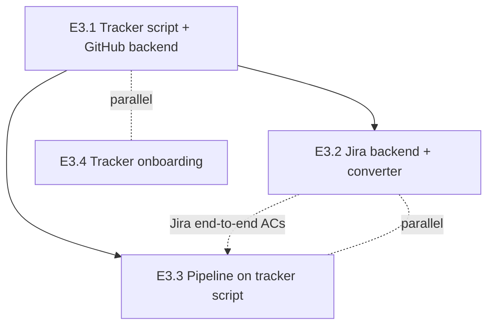

# V3 Implementation Plan

**Date:** 2026-11-15
**Version:** v3
**HLD:** [v3-design.md](../design/v3/v3-design.md) (v0.4)
**Requirements:** [v3-requirements.md](../requirements/v3-requirements.md) (v1.0)
**Related ADRs:** [ADR-0041](../adr/0041-tracker-abstraction.md) (tracker abstraction),
[ADR-0018](../adr/0018-epic-task-organisation.md) (epic model, 2026-11-15 revision),
[ADR-0026](../adr/0026-stable-ids-requirements-lld.md) (REQ anchors),
[ADR-0037](../adr/0037-incremental-session-logging.md) (session-log naming)

## Overview

V3 lets a host project track work in Jira Cloud while code, PRs and CI stay on GitHub. It
puts every issue operation behind one tracker script with a GitHub and a Jira backend, moves
all 28 call sites onto it, and teaches `/setup` to configure it. Why now: teams that plan in
Jira cannot adopt EDF without double-keeping work items, and the scattered `gh issue` calls
make each new skill harder to port the longer this waits.

## Out of Scope

From the requirements' *What We Are NOT Building*:

- Jira Server / Data Center, OAuth, company-managed projects
- Configurable status or issue-type mapping
- Moving PRs, CI or reviews off GitHub
- Migrating or syncing existing GitHub issues
- Sprint management, retries/back-off, a standalone connection check

## Story split across epics — read before assigning work

Stories 1.1–1.5 each carry both GitHub-parity and Jira ACs. They are split by AC: **E3.1**
owns the tracker contract and every GitHub AC; **E3.2** owns every Jira AC. Both epics list
the same anchors, with the AC split stated. A story closes when both epics' halves are done.

## Epics

### Epic E3.1 — Tracker script and GitHub backend

- **HLD anchor:** [C3.1](../design/v3/v3-design.md#c31-tracker-script),
  [C3.2](../design/v3/v3-design.md#c32-github-backend)
- **Scope:** Introduce the tracker script and its contract, with today's GitHub behaviour
  moved behind it unchanged.
- **Requirements covered:**
  - `REQ-tracker-script-select-tracker-from-environment` — Story 1.1: selection, env
    precedence, missing-var and `https://` validation (AC1–AC5)
  - `REQ-tracker-script-create-issue` — Story 1.2: GitHub AC9, `--type epic` label (AC4),
    `--dry-run` (AC7)
  - `REQ-tracker-script-view-and-list-issues` — Story 1.3: GitHub AC9 (shared JSON shape)
  - `REQ-tracker-script-edit-and-comment` — Story 1.4: GitHub half
  - `REQ-tracker-script-change-status` — Story 1.5: status vocabulary (AC6), GitHub AC7
  - `REQ-pipeline-on-jira-native-epics` — Story 2.1: AC4 (GitHub checkbox via `close`)
- **Owns (components):** C3.1 Tracker Script, C3.2 GitHub Backend
- **Touches (components):** `_edf_env.py` (reads only); `gh-create-issue.sh`,
  `gh-project-status.sh`, `check-epic-checkbox.py` (become shims or are absorbed)
- **Depends on:** none
- **Parallelisable with:** E3.4
- **Rough task shape:**
  - Tracker entry point: argument grammar, env resolution, backend selection, Jira config
    validation, `tracker` command, output and error contract, `--dry-run`
  - GitHub `create` and `status`, ported with byte-identical output; existing
    `gh-create-issue.sh` / `gh-project-status.sh` tests pass unchanged through shims
  - GitHub `view` / `list` / `edit` / `comment`, with `parent` and `children` parsed from
    bodies (ADR-0018)
  - GitHub `close`: board → epic tick → `gh issue close`, idempotent; absorbs
    `check-epic-checkbox.py`
- **Exit criteria:** with `JIRA_HOST` unset, every existing script test passes unchanged
  through the shims; every tracker operation has GitHub tests; `JIRA_HOST` set with a missing
  variable fails with the named error and no network call.

### Epic E3.2 — Jira backend and Markdown↔ADF converter

- **HLD anchor:** [C3.3](../design/v3/v3-design.md#c33-jira-backend),
  [C3.4](../design/v3/v3-design.md#c34-markdownadf-converter)
- **Scope:** Implement every tracker operation against a team-managed Jira Cloud space, with
  bodies and comments stored as ADF.
- **Requirements covered:**
  - `REQ-tracker-script-select-tracker-from-environment` — Story 1.1: AC6 (401/403), AC7
    (429/5xx), token redaction
  - `REQ-tracker-script-create-issue` — Story 1.2: Jira AC1–AC6, AC8 (JQL escaping)
  - `REQ-tracker-script-view-and-list-issues` — Story 1.3: Jira AC1–AC8 (round-trip, rank,
    cap)
  - `REQ-tracker-script-edit-and-comment` — Story 1.4: Jira AC1–AC5
  - `REQ-tracker-script-change-status` — Story 1.5: Jira AC1–AC5 (transitions, missing
    Blocked)
  - `REQ-pipeline-on-jira-jira-references-in-prs-and-logs` — Story 2.2: AC4 mechanics
    (Jira `close` → Done)
- **Owns (components):** C3.3 Jira Backend, C3.4 Markdown↔ADF Converter
- **Touches (components):** C3.1 (registers the Jira backend); `tests/` fake-server fixture;
  `CLAUDE.md` § Coding Principles (respx exception, per ADR-0041)
- **Depends on:** E3.1 (contract and dispatch)
- **Parallelisable with:** E3.3, E3.4. The converter task has no dependency and can start
  alongside E3.1.
- **Rough task shape:**
  - Converter Markdown → ADF and ADF → Markdown for the Supported Markdown subset, with
    round-trip and unsupported-content tests
  - HTTP client: basic auth, error mapping, redaction; fake Jira server fixture for tests
  - `create`: escaped-JQL dedup, Task/Epic type, parent validation
  - `view` / `list`: JQL search, rank order, 100 cap, status mapping, children
  - `edit` / `comment` / `status` / `close`: label add/remove, transitions with no-op and
    missing-Blocked handling
- **Exit criteria:** every Jira AC in Stories 1.1–1.5 passes against the fake server; a manual
  smoke run (create epic + task, view, status, close) succeeds against `SCRUM`; the token
  appears in no captured output.

### Epic E3.3 — Pipeline on the tracker script

- **HLD anchor:** [C3.5](../design/v3/v3-design.md#c35-feature-identity-resolver)–[C3.8](../design/v3/v3-design.md#c38-issue-access-guard)
- **Scope:** Move all 28 call sites onto the tracker script, derive `FEATURE_ID` in one place,
  read epic progress from the tracker, and lock the route with a guard test.
- **Requirements covered:**
  - `REQ-pipeline-on-jira-native-epics` — Story 2.1: AC1–AC3 (call sites, progress)
  - `REQ-pipeline-on-jira-jira-references-in-prs-and-logs` — Story 2.2: AC1–AC6 (identity,
    PR body, `/feature-end` calls `close` only after merge)
  - `REQ-pipeline-on-jira-route-all-issue-calls-through-tracker-script` — Story 2.3: AC1–AC7
- **Owns (components):** C3.5 Feature Identity Resolver, C3.6 Epic Progress Reader,
  C3.7 Pipeline Call Sites, C3.8 Issue-Access Guard
- **Touches (components):** C3.1 (calls only); session tagging, checkpoint and cost tooling
  (consume `FEATURE_ID`)
- **Depends on:** E3.1. Its Jira end-to-end ACs (2.3 AC2–AC3, AC6) also need E3.2.
- **Parallelisable with:** E3.2, E3.4
- **Rough task shape:**
  - Feature identity resolver and its consumers (`tag-session`, `append-checkpoint`,
    `query-feature-cost`, session-log naming, `create-feature-pr` PR-body line)
  - Epic progress reader, resolving HLD Open Question 1 (per-child `view` or child statuses
    in `view` JSON)
  - Call-site migration by pipeline area, one PR each: planning (`kickoff`, `architect`,
    `gh-issue-manager`; Jira epic body has no task checklist per ADR-0018 revision);
    implementation (`feature`, `feature-core`, `feature-end` → `close`); everything else
    (`bug`, `backlog`, `lld-sync`, agents, bin, `starters/`, flowcharts)
  - Guard test, landed last, then shims from E3.1 removed
- **Exit criteria:** the guard test passes with no exclusions beyond C3.2; GitHub-configured
  `/architect`, `/feature`, `/backlog` behave as today; a manual `/qa` run on `SCRUM` covers
  `/architect` → `/feature` → `/feature-end`.

### Epic E3.4 — Tracker onboarding

- **HLD anchor:** [C3.9](../design/v3/v3-design.md#c39-tracker-onboarding)
- **Scope:** `/setup` asks which tracker to use and writes Jira placeholders without
  overwriting.
- **Requirements covered:**
  - `REQ-onboarding-setup-configures-tracker` — Story 3.1: AC1–AC4
- **Owns (components):** C3.9 Tracker Onboarding
- **Touches (components):** `.env`, `.gitignore` handling in `/setup`
- **Depends on:** none (writes variable names only; needs no tracker code)
- **Parallelisable with:** E3.1, E3.2, E3.3
- **Rough task shape:** single task: tracker prompt, placeholder append, `.gitignore` check,
  required-statuses message
- **Exit criteria:** Story 3.1 ACs pass on a fresh repo and on one with an existing `.env`.

## Parallelisation Map

E3.1 goes first. E3.2 and E3.3 then run in parallel: their `Owns` sets are disjoint, and E3.3
can migrate and verify call sites on GitHub before the Jira backend lands. E3.3's final Jira
`/qa` run waits for E3.2. E3.4 is independent and can be picked up at any time. File-level
conflicts (both E3.2 and E3.3 touch `CLAUDE.md` and `tests/`) are checked in `/architect`.
