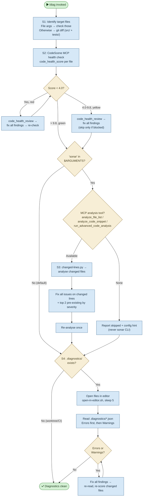

# /diag — Process flowchart

Visual overview of the on-demand diagnostics check. Identifies target files, runs CodeScene MCP health checks, runs SonarQube MCP analysis of the changed files (S3, only when invoked as `edf:diag sonar`), and reads diagnostics-exporter output last — skipped without error when `.diagnostics/` does not exist. Decisions are orange.

